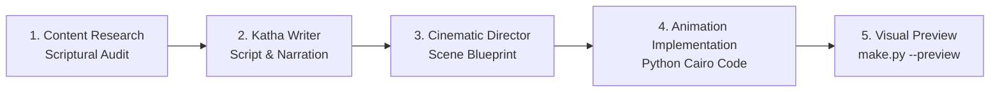
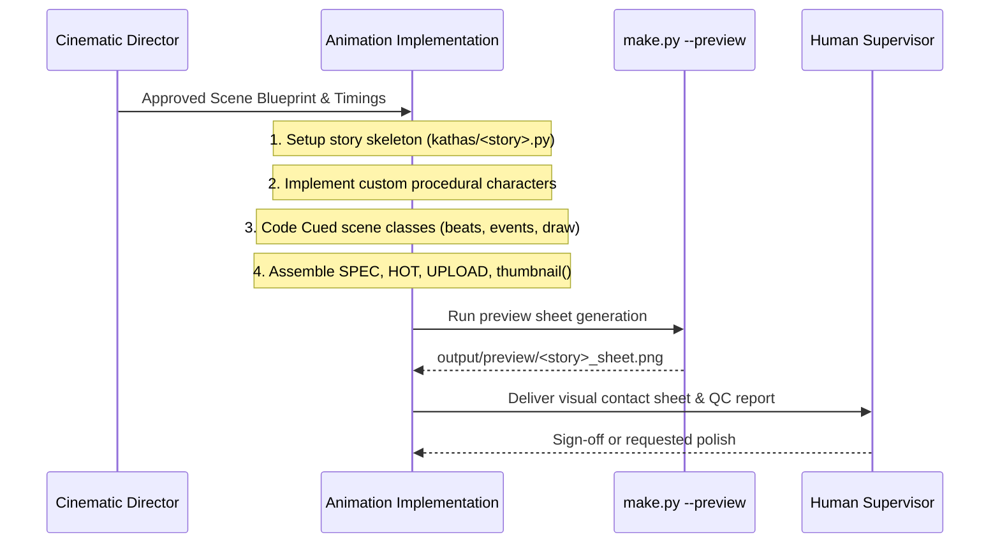

# Animation Implementation Skill

## Role & Purpose
The `animation-implementation` skill acts as the lead procedural graphics programmer and technical animator for **Sanatan Katha YouTube Shorts** (`story-pipeline/SanatanKatha/`).

It converts approved narration scripts (from `katha-writer`) and scene-direction blueprints (from `cinematic-director`) into clean, robust, and mathematically sound procedural Python code using the 2D Cairo rendering engine (`core/katha.py`, `core/devta.py`, and `core/engine.py`).



---

## Non-Negotiable Engine Constraints

All code generated through this skill must strictly respect the engine boundaries:

1. **Cairo Context Lifecycle & Ownership (`ctx.save()` / `ctx.restore()`)**:
   - `place(ctx, x, y, s, t, flip)` in `core/devta.py` (lines 170–175) performs `ctx.save()`, translates to $(x, y)$, applies breathing oscillation, and scales $(-s \text{ if flip else } s, s \cdot b)$.
   - **Ownership Rule**: `place()` **never** restores context. Therefore, **the immediate function/closure that invokes `place()` owns context-state restoration and MUST execute `ctx.restore()` before exiting**.
   - **Caller Rule**: Functions calling character routines (e.g. `Scene.draw()` calling `dv.krishna()`) must **NEVER** call `ctx.restore()` after the character call, because native routines (`krishna`, `barbarik`, `devi`, etc.) already balance their own context internally.
   - **Unmatched Operation Prohibition**: Never perform unmatched `ctx.save()` or `ctx.restore()` calls. If a custom helper does not call `place()` or `ctx.save()`, calling `ctx.restore()` will pop the compositor's camera or cause a fatal Cairo stack underflow.
   - *Failure to balance leaks the flipped scaling matrix (`scale(-s, s)`), causing subsequent characters to be thrown off-screen and all subtitles to render backwards / mirrored ("ulta").*

2. **Character Scaling & Framing (Recommended Standard & Exceptions)**:
   - **Recommended Standard Range**: **`0.68` to `0.80`** for typical full-body standing dialogue and two-character interactions.
   - At this standard range, feet sit at `GROUND - 10` ($y \approx 1170$) and crowns stay at $y \approx 500–550$, leaving clean breathing room under the top header ($y = 78–146$) and avoiding collisions with bottom captions ($y = 1290$).
   - In 2-character scenes, position characters at $x \approx 230–250$ and $x \approx 750–850$ (~500px separation) so neither clips against screen borders.
   - **Supported Framing Exceptions**:
     - *Distant / Flanking / Miniature*: $s = 0.30–0.60$ (e.g. background armies, entering deities, jumping miniature figures across battlefields).
     - *Seated Characters (Padmasana / Dhyan / Throne)*: $s = 0.74–0.85$ with custom $y$ placement (e.g. Lord Brahma on lotus at $y \approx 700–740$; seated figures are naturally vertically shorter and need scale compensation to maintain visual parity with standing characters).
     - *Composite / Cosmic Deities*: $s = 0.72–0.78$ centered at $x = 540$ (e.g. unified Hari-Hara form).
     - *Close-ups / Dramatic Busts*: $s = 0.85–1.10$ centered to highlight expressions or sheesh roop.
     - *Thumbnail Covers (`thumbnail(ctx)`)*: $s = 0.85–1.10$ for high visual prominence on mobile screens.

3. **Typography & Script (Zero Tofu Squares `□□□`)**:
   - Cairo text rendering with `CAPTION_FONT` (`Impact`) lacks Devanagari glyphs.
   - Any raw Devanagari characters in ribbons, cards, or on-screen UI will produce empty tofu boxes (`□□□`).
   - **Mandatory Rule**: ALWAYS use capitalized Roman transliteration for all on-screen graphics, ribbons, cards, and titles (`dv.ribbon()`, `title_card()`). The spoken voiceover remains authentic Hindi.

4. **UI Placement & Clean Screen Rule**:
   - Never place cards, speech bubbles, or ribbons over the central deity or character's body ($y = 800–1000$).
   - At most **one** single sleek ribbon per scene placed at $x = 540, y = 280–320$.
   - Never stack multiple ribbons or mix `title_card()` with `ribbon()`.

5. **Reverence & Non-Violence**:
   - Sacred deities and divine beings must be treated with supreme reverence.
   - Mortal sacrifices, boons, or head donations (e.g. Barbarik's *sheesh daan*) must be visualized solely through celestial light dissolving, lotus blossoms (`dv.lotus`), falling petals (`dv.petals`), and golden aura flares—**never graphic gore, blood, or physical violence**.

6. **Safety Boundary**:
   - Never modify `core/engine.py`, `core/katha.py`, `core/devta.py`, `make.py`, or `RealityShift/`.
   - Write clean, modular code inside the story file `kathas/<story_name>.py`.

---

## Anatomy of a Katha Story Module

Every katha module in `kathas/<story_name>.py` must implement the following standardized interface:

```python
"""Story Module Title (~60-90s katha, N scenes)."""

import math
from pathlib import Path
import sys

_ROOT = Path(__file__).resolve().parent.parent
if str(_ROOT) not in sys.path:
    sys.path.insert(0, str(_ROOT))

import cairo
from core import engine, katha
from core.katha import *
import core.devta as dv

# 1. Metadata & Audio Configuration
TOPIC = "STORY TOPIC IN UPPERCASE"
OUTPUTS = {"edge": "<story_name>_short.mp4"}
MUSIC_STYLE = "ambient"      # Devotional ambient pads (no repetitive drone)
MUSIC_BPM = 88               # Appropriate tempo (80-92 BPM)
MUSIC_VOLUME = 0.12          # 0.10-0.12 so dialogue stays crisp
TAIL_PAD = 0.04              # Tight scene transitions (no long silences)
MAX_GAP = 0.04               # Continuous spoken flow

# 2. Scriptural Sources & Evidence Base
SOURCES = [
    "Source 1: Canonical Sanskrit text (Khanda, Chapter, Verses)",
    "Source 2: Secondary recension or regional folk tradition",
]

# 3. SPEC Definition (Scenes, Visuals, Lines)
SPEC = [
    {
        "key": "hook",
        "text": "ON-SCREEN TITLE",
        "visual": "Director's cinematic visual description",
        "vo": [
            ("tell", [
                ("हिंदी बोला जाने वाला वाक्य,", "ROMAN TRANSLITERATION,"),
                ("अगला वाक्य।", "NEXT SENTENCE."),
            ])
        ]
    },
    # ... additional scenes
]

# 4. Script Processing & Hot Words Mapping
DELIVERY, SCRIPT, NARRATION = script_of(SPEC)

HOT = hot_words({
    "KEYWORD": GOLD_HI,
    "DEITY": DIVINE,
    "ACTION": SAFF,
})

# 5. Scene Classes (Cued Implementation)
class HookScene(Cued):
    def beats(self, d):
        c = self.cue
        return {
            "action": c("KEYWORD", d * 0.4),
        }

    def events(self, d):
        b = self.beats(d)
        return [
            (0.02, "soft_thud"),
            (b["action"], "shimmer"),
        ]

    def draw(self, ctx, t, d):
        b = self.beats(d)
        # 10-layer standard procedural drawing hierarchy
        battlefield(ctx, t)
        dv.barbarik(ctx, 540, GROUND - 10, 0.74, t, pose="stand")
        dv.ribbon(ctx, "ON-SCREEN TITLE", 540, 280, t - b["action"], size=78)

# 6. Scene Registry & YouTube Upload Kit
SCENE_CLASSES = {
    "hook": HookScene,
}

UPLOAD = {
    "title": "Clean YouTube Short Title",
    "thumb_text": "HOOK TEXT?",
    "queries": ["search phrase 1", "search phrase 2"],
    "description": "Short description...",
    "tags": ["tag1", "tag2"],
    "hashtags": ["#Shorts", "#SanatanKatha"],
}

# 7. Thumbnail Cover Routine
def thumbnail(ctx):
    """1080x1920 cover layout."""
    temple_bg(ctx, 0.0)
    dv.barbarik(ctx, 540, GROUND - 40, 0.85, 0.3, pose="stand")
    # Title overlay...
```

---

## 10-Layer Procedural Drawing Hierarchy

Inside every `draw(ctx, t, d)` method, render strictly from back to front:

| Layer | Component | Function / Primitive | Notes |
| :--- | :--- | :--- | :--- |
| **01** | Sky & Atmosphere | `dv.sky()`, `glow()`, `dv.stars()` | Base environment lighting |
| **02** | Deep Background | Silhouettes, mountain ridges, `dv.kailash()` | Distant scale & depth |
| **03** | Midground Props | `dv.peepal()`, `dv.hill()`, `dv.temple_bg()` | Architectural / nature anchor |
| **04** | Ground Terrain | Rectangles, grass lines, `battlefield()`, `meadow()` | Ground plane at `GROUND = 1180` |
| **05** | Celestial Back-FX | `dv.halo()`, `glow()`, aura discs | Emanating behind characters |
| **06** | Characters | `dv.krishna()`, `dv.barbarik()`, custom figures | Scaled $0.68–0.80$, feet on ground |
| **07** | Props & Weapons | `dv.divine_arrow()`, `dv.yagya_kund()`, `dv.lotus` | Held items, active tools |
| **08** | Dynamic FX | `dv.petals()`, light beams, shockwaves, smoke | Flying particles and energy |
| **09** | On-Screen Graphics | `dv.ribbon()` | Capitalized Roman transliteration |
| **10** | Compositor Auto | Diya Header, Kinetic Captions, Golden Flash | Automatic via `core/katha.py` |

---

## Timing, Cues, and Sound Design Synchronization

### 1. `beats(d)` — Word-Level Synchronization
The `Cued` base class provides `self.cue(word, default_time)`. It looks up when a specific word or phrase in the Roman caption appears in the scene:
```python
def beats(self, d):
    c = self.cue
    return {
        "curse": c("CURSE", d * 0.35),
        "boon": c("BOON", d * 0.70),
    }
```
*Always provide a sensible fallback proportion of duration $d$ (e.g. $d \times 0.4$) in case word alignment has not yet occurred.*

### 2. `events(d)` — SFX Cueing
Returns a list of `(timestamp_in_seconds, sfx_name)` tuples.
Supported built-in SFX in `core/engine.py`:
- `soft_thud` / `thud`: Scene entry or grounding impact.
- `shimmer`: Divine reveal, celestial appearance, blessing.
- `ghanti`: Temple bell strike with decaying resonance (~3.2s).
- `arrow`: High-frequency whistle and flight rush (~0.6s).
- `boom`: Heavy cinematic sub-bass drop for revelation/climax.
- `whoosh`: Air rush for quick camera pans or magic manifestations.
- *Strict Rule*: Do NOT use `shankh` repeatedly across shorts.

### 3. Interpolation & Easing Math
Always use smooth easing curves for visual transitions:
- `clamp(v, lo=0.0, hi=1.0)`: Keeps values in safe bounds.
- `lerp(a, b, u)`: Linear interpolation between two coordinates.
- `ease_out_cubic(u)`: Decelerating curve, ideal for character entrances and objects coming to rest.
- `ease_out_back(u)`: Subtle overshoot and settle, ideal for UI ribbons, popped cards, and dropped weapons.
- `ease_in_out(u)`: S-curve, ideal for breathing, floating arrows, and camera pivots.

---

## Custom Character Procedural Pattern

When depicting figures not present in `core/devta.py` (e.g. Lord Brahma, Hari-Hara composite, Maharshi Vishwamitra), define a dedicated procedural drawing routine inside `kathas/<story_name>.py`:

```python
def brahma(ctx, x, y, s, t, pose="bless", flip=False, a=1.0):
    """Lord Brahma: Golden mukut, celestial halo, white beard, lotus throne."""
    def draw():
        place(ctx, x, y, s, t, flip)  # <--- Calls ctx.save() internally
        
        # 1. Back aura & halo
        halo(ctx, 0, -640, 190, t, c=GOLD_HI)
        
        # 2. Lotus Seat (underneath)
        dv.lotus(ctx, 0, -30, 120, t)
        
        # 3. Body & Pitambar Robes
        skin = dv.KRISHNA_SKIN  # or custom fair tone
        # draw torso, dhoti, ornaments...
        
        # 4. White Beard (Ascetic Grandeur)
        smooth(ctx, [(-30, -580), (0, -490), (30, -580)])
        ink(ctx, (1.0, 1.0, 1.0))
        
        # 5. Golden Mukut
        # draw crown...
        
        ctx.restore()  # <--- MANDATORY! Must restore before exiting draw()
        
    dv.group(ctx, a, draw)
```

### Composite Figure Pattern (`ctx.clip()`)
For complex composite forms such as **Hari-Hara** (half Vishnu, half Shiva):
1. Save context: `ctx.save()`.
2. Clip left half: `ctx.rectangle(-400, -1000, 400, 1200); ctx.clip()`.
3. Draw Vishnu half (cyan skin, pitambar dhoti, Sudarshana Chakra, peacock crown).
4. Restore context: `ctx.restore()`.
5. Save context: `ctx.save()`.
6. Clip right half: `ctx.rectangle(0, -1000, 400, 1200); ctx.clip()`.
7. Draw Shiva half (ash skin, tiger skin dhoti, Trishul, crescent moon in jata).
8. Restore context: `ctx.restore()`.

---

## Step-by-Step Implementation Workflow



1. **Intake & Verification**:
   - Verify approved script narration and exact word counts from `katha-writer`.
   - Verify scene breakdown, camera movements, character scales, and cues from `cinematic-director`.
2. **Skeleton Construction**:
   - Initialize `kathas/<story_name>.py` with metadata (`TOPIC`, `MUSIC_BPM`, `TAIL_PAD`).
   - Populate `SOURCES` and `SPEC` with verified lines.
   - Run `DELIVERY, SCRIPT, NARRATION = script_of(SPEC)`.
3. **Procedural Characters**:
   - Inspect required characters. If native to `devta.py`, invoke directly.
   - If custom, write isolated drawing routines ensuring every `place()` has a matching `ctx.restore()`.
4. **Scene Class Coding**:
   - Implement `beats(d)` mapping narration keywords.
   - Implement `events(d)` matching SFX beats.
   - Implement `draw(ctx, t, d)` adhering to the 10-layer standard hierarchy.
5. **Thumbnail & Upload Kit**:
   - Implement `thumbnail(ctx)` featuring high-contrast cover art, prominent deity, and bold text.
   - Define `UPLOAD` dictionary with 10 titles, description, tags, and hashtags.
6. **Multi-Level Validation Gate**:
   - Follow the rigorous 5-level validation hierarchy before presenting code for production sign-off.
   - Never classify a script or template as production-ready solely because it passes AST syntax checks.

---

## The 5-Level Validation Hierarchy

Procedural graphics code must pass five distinct levels of verification. Passing an earlier level never guarantees success at subsequent levels:

```
[Level 1: Syntax AST] -> [Level 2: Import & Module] -> [Level 3: Policy & Metadata] -> [Level 4: Procedural Execution] -> [Level 5: Visual Preview]
```

| Level | Validation Stage | Execution Command | Scope of Verification | What It Does NOT Verify |
| :---: | :--- | :--- | :--- | :--- |
| **1** | **Python Syntax AST** | `python -m py_compile kathas/<story>.py` | Validates Abstract Syntax Tree (AST), grammar, indentation, unclosed brackets/strings. | Does NOT check imports, runtime symbols, method logic, or drawing primitives. |
| **2** | **Module Import** | `python -c "import kathas.<story>"` | Validates that all module-level imports resolve (`core.katha`, `core.devta`), global constants exist, and `script_of()` executes. | Does NOT instantiate scene classes, test `beats()`, execute `draw()`, or check rendering. |
| **3** | **Engine Policy & Metadata** | `python make.py <story> --check` | Validates YouTube Partner Program (YPP) policy gate in `core/policy.py`, `SPEC` key matching, hot-word mappings, and upload metadata. | Does NOT test Cairo drawing contexts, matrix balance, or visual composition. |
| **4** | **Procedural Drawing Execution** | *Programmatic dry-run of scene `draw(ctx, t, d)`* | Validates that drawing primitives execute without `NameError`, math exceptions (`ZeroDivisionError`), or unhandled types. | Does NOT verify aesthetic framing, visual overlap, or absence of tofu squares. |
| **5** | **Visual Preview Render** | `python make.py <story> --preview` | Compiles frames via `core/katha.py:compose()` into `output/preview/<story>_sheet.png` & `thumb.png` for human inspection. | Human visual QC: confirms zero tofu glyphs, zero mirrored text, proper framing, and clear contrast. |

> [!CRITICAL]
> **Production-Tested Standard**: Passing `py_compile` is merely Level 1 (syntax validity). Code is only classified as **Production-Ready** when it has passed all five levels, culminating in human inspection of the visual preview contact sheet.

---

## Debugging Playbook & Visual QC

### 1. Matrix Leaks / Mirrored Subtitles ("Ulta" Text)
- **Symptom**: Subtitles at the bottom or subsequent characters appear inverted, backwards, or shifted violently off-screen.
- **Root Cause**: A custom character or prop called `place(ctx, ..., flip=True)` without calling `ctx.restore()`.
- **Fix**: Audit every `place(ctx, ...)` call in the file and ensure there is an exact matching `ctx.restore()` before exiting the closure.

### 2. Tofu Glyph Squares (`□□□`)
- **Symptom**: Ribbons or cards display empty boxes instead of text.
- **Root Cause**: Raw Devanagari text passed to `dv.ribbon()`, `title_card()`, or `text()` with `CAPTION_FONT = "Impact"`.
- **Fix**: Convert the on-screen text to uppercase Roman transliteration (e.g. replace `"कर्म चक्र"` with `"KARM CHAKRA"`).

### 3. Screen Clipping & Massive Characters
- **Symptom**: Crown intersects top diya header or feet extend below captions.
- **Root Cause**: Character scale $s > 0.82$ or character $y$ offset set above `GROUND - 10`.
- **Fix**: Standardize character scale between $0.68$ and $0.80$ and place feet at $y \approx 1170$.

### 4. Audio Stutter / Lag Between Scenes
- **Symptom**: Awkward 0.5s dead silence between scenes during playback.
- **Root Cause**: `TAIL_PAD` set to default $0.15$ or `MAX_GAP` set high.
- **Fix**: Set `TAIL_PAD = 0.04` and `MAX_GAP = 0.04` at the top of the story module.

---

## Rollback & Safety Protocol

1. **Local Versioning**:
   - Before modifying an existing katha, save a working checkpoint or git commit.
2. **Zero Modification to Engine Core**:
   - If an effect cannot be achieved with existing engine primitives, write a local helper function inside `kathas/<story_name>.py`. NEVER alter `core/katha.py`, `core/devta.py`, or `core/engine.py`.
3. **Clean Preview Testing**:
   - Always run `--preview` first. Never attempt a full render (`python make.py <story>`) without human inspection of the visual preview sheet.

