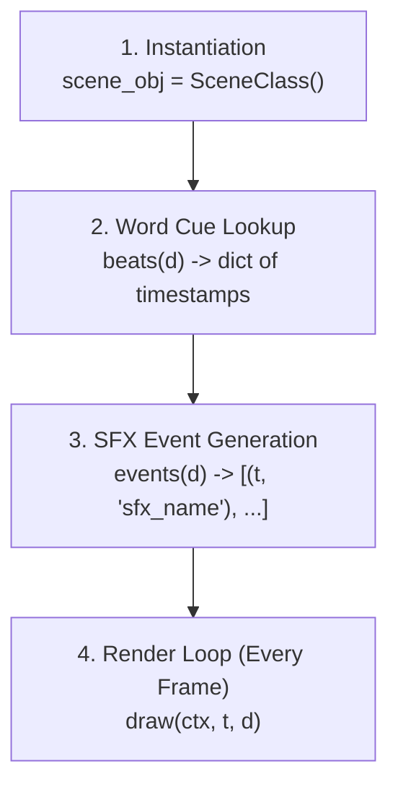
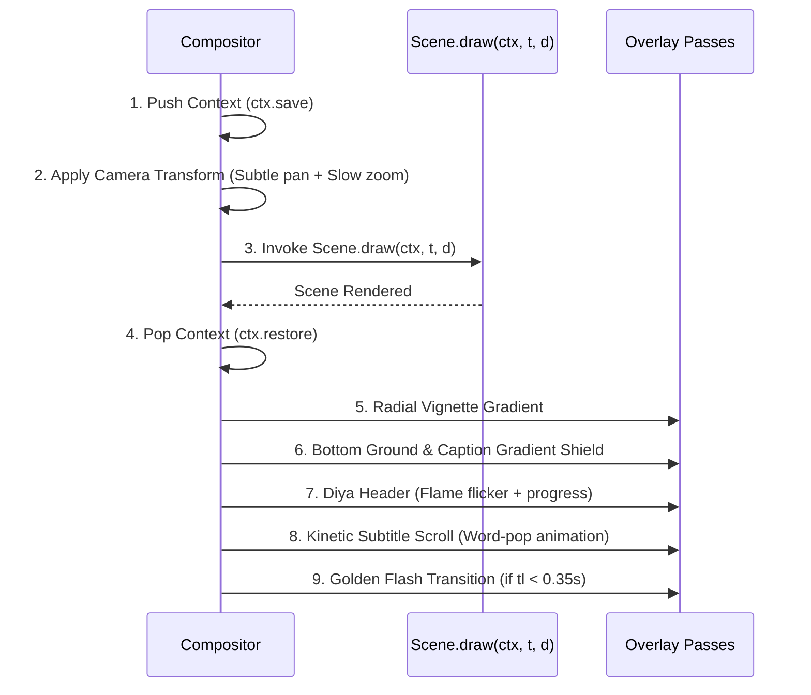

# Cairo Animation Engine Architecture Reference

## Overview
Sanatan Katha's animation system is a procedural 2D vector animation pipeline built entirely on **Pycairo**, **NumPy**, and **MoviePy**. It produces mathematically pristine, resolution-independent 1080×1920 (9:16 vertical) animations at 30 FPS for YouTube Shorts without requiring external 3D software or pre-rendered sprite assets.

This document describes the exact architecture, lifecycle, coordinate systems, and composition pipeline implemented in `story-pipeline/SanatanKatha/core/`.

---

## 1. Canvas & Coordinate Geometry

```
(0, 0) ---------------------------------------------------- (1080, 0)
|                                                                   |
|   TOP HEADER SAFE ZONE (y = 78 - 146)                             |
|   - Diya sequence lights up per scene progress                    |
|   - Channel title: "DIVYA RAHASYA"                                |
|                                                                   |
|   UPPER MID-CANVAS (y = 280 - 450)                                |
|   - Optimal placement for sleek ribbons: dv.ribbon()              |
|   - Optimal placement for divine orbs, celestial halos, sun/moon  |
|                                                                   |
|   CENTRAL DEITY FOCUS ZONE (y = 500 - 1100)                       |
|   - Primary character bodies, divine interactions, weapons        |
|   - Sacred tree branches, mountain peaks, temple vimana           |
|                                                                   |
|   GROUND HORIZON (y = 1180 = GROUND)                              |
|   - Ground line where all characters stand: GROUND - 10           |
|   - Terrain rectangles, rolling hills, temple floors              |
|                                                                   |
|   KINETIC CAPTIONS ZONE (y = 1290 = CAP_Y)                        |
|   - Scroll background with gold borders                           |
|   - Word-by-word popping Impact font                              |
|                                                                   |
|   BOTTOM SHADOW MASK (y = 1520 - 1920)                            |
|   - Dark gradient and solid rectangle protecting captions         |
(0, 1920) ------------------------------------------------ (1080, 1920)
```

### Core Constants (`core/katha.py` & `core/engine.py`):
- `W = 1080`: Canvas width in pixels.
- `H = 1920`: Canvas height in pixels.
- `FPS = 30`: Frame rate.
- `SR = 44100`: Audio sample rate in Hz.
- `GROUND = 1180`: Standard horizontal baseline where characters' feet rest ($y = \text{GROUND} - 10 \approx 1170$).
- `CAP_Y = 1290`: Vertical center of kinetic subtitle scrolls.
- `CAPTION_FONT = "Impact"`: Font for subtitles and title graphics.
- `UI_FONT = "Segoe UI"`: Font for auxiliary UI elements.

---

## 2. Pipeline Execution Modes (`make.py`)

The pipeline CLI exposes five primary operations:

```bash
# 1. Preview Contact Sheet (FASTEST - No voice required)
# Generates a 2-moment contact sheet of every scene + thumbnail in output/preview/
python make.py <story_name> --preview

# 2. YouTube Partner Program Policy Gate
# Verifies non-reused narration, script structure, hot words, and metadata
python make.py <story_name> --check

# 3. KikiVoice Text Export
# Generates clean, character-separated text files for manual/Kiki recording
python make.py <story_name> --kiki-export

# 4. KikiVoice Audio Split & Alignment Check
# Aligns downloaded user audio into scene clips and verifies timestamps
python make.py <story_name> --kiki-split

# 5. Full Short Render
# Compiles music bed, SFX, voice clips, 30 FPS frames, and YouTube upload kit
python make.py <story_name>
```

---

## 3. Scene Lifecycle & Class Architecture

Each scene is represented as a subclass of `Cued` in `kathas/<story_name>.py`:



### 1. `beats(self, d)`
Computes critical animation timestamps based on caption hot-words or elapsed time fractions:
```python
def beats(self, d):
    c = self.cue
    return {
        "reveal": c("SUDARSHAN", d * 0.45),
        "climax": c("SHEESH", d * 0.75),
    }
```
- `self.cue(word, default)`: Checks the word timestamps loaded from Whisper alignment or provisional timings.
- Returns a dictionary of floats representing local scene seconds ($0.0 \le t \le d$).

### 2. `events(self, d)`
Returns a list of audio events triggered at specific scene times:
```python
def events(self, d):
    b = self.beats(d)
    return [
        (0.02, "soft_thud"),
        (b["reveal"], "shimmer"),
        (b["climax"], "boom"),
    ]
```

### 3. `draw(self, ctx, t, d)`
Renders the scene at local time $t$ ($0.0 \le t \le d$).
- `ctx`: Active Cairo context.
- `t`: Current local timestamp in seconds.
- `d`: Total duration of the scene in seconds.

---

## 4. The Active Compositor Pipeline (`compose(story, idx, tl)`)

Every frame generated by `core/katha.py:compose()` goes through a strictly ordered multi-pass compositor:



### Camera Dynamics Implementation
The camera automatically applies a gentle cinematic drift to every scene:
```python
zoom = 1.0 + 0.045 * tl / sc["dur"]
ctx.save()
ctx.translate(W / 2 + 8 * math.sin(tl * 0.5 + idx), H * 0.4)
ctx.scale(zoom, zoom)
ctx.translate(-W / 2, -H * 0.4)
sc["obj"].draw(ctx, tl, sc["dur"])
ctx.restore()
```
- **Scale**: Linear zoom of $+4.5\%$ across the scene duration.
- **Horizontal Pan**: Gentle sinusoidal sway with an amplitude of $8\text{px}$.
- **Center of Pivot**: $(540, 768)$, perfectly centered on characters' upper bodies.

### Automatic Scene Transitions
At the start of every scene after the first (`idx > 0`), the compositor overlays a golden burst of light decaying over $0.35\text{s}$:
```python
if idx and tl < 0.35:
    glow(ctx, W / 2, H * 0.4, 1300, (1, 0.9, 0.6), 0.85 * (1 - tl / 0.35))
```

---

## 5. Built-in Procedural SFX Bank (`core/engine.py`)

The engine generates all sound effects synthetically via NumPy math at $44.1\text{ kHz}$. No external `.wav` files are required:

| SFX Name | Audio Characteristics | Typical Duration | Best Used For |
| :--- | :--- | :--- | :--- |
| `soft_thud` | Low-frequency damped pulse | $\approx 0.3\text{s}$ | Scene entry, character step |
| `thud` | Sub-frequency impact | $\approx 0.3\text{s}$ | Weapon grounding, heavy shield |
| `boom` | Sub-bass drop + shaped noise | $\approx 1.0\text{s}$ | Divine revelation, cosmic turning point |
| `shimmer` | Ascending bell arpeggio | $\approx 1.8\text{s}$ | Celestial appearance, boon granted |
| `ghanti` | Sacred temple bell with long ring | $\approx 3.2\text{s}$ | Prayer, divine presence, temple gates |
| `shankh` | Resonant sacred conch horn | $\approx 2.6\text{s}$ | *Use sparingly!* Major battle declaration |
| `arrow` | High-frequency whistle + air rush | $\approx 0.6\text{s}$ | Arrow release, celestial weapon launch |
| `whoosh` | Sweeping filtered noise swell | $\approx 0.55\text{s}$ | Rapid camera movement, magic swirl |
| `tick` / `tock` | Filtered click tones | $\approx 0.05\text{s}$ | Counting, time ticking, quick beats |
| `zap` | Descending laser chirp | $\approx 0.25\text{s}$ | Cosmic laser, energy bolt |
| `pop` | Tiny resonant click | $\approx 0.04\text{s}$ | Leaf puncture, dot appearance |

---

## 6. Context State Isolation Mechanics & Ownership

### Source Code Evidence: `place()` in `core/devta.py` (lines 170–175)
```python
def place(ctx, x, y, s, t, flip=False, breathe=True):
    """Enter a character's local frame: feet at (x, y), y up is negative."""
    ctx.save()
    ctx.translate(x, y)
    b = 1 + (0.012 * math.sin(t * 2.2) if breathe else 0)
    ctx.scale(-s if flip else s, s * b)
```

### Analysis of Context Lifecycle & Ownership
1. **Where `ctx.save()` is called**:
   - `place()` calls `ctx.save()` on line 172. It then applies coordinate translation to $(x, y)$ and scaling with optional horizontal flip.
2. **Where `ctx.restore()` is NOT called**:
   - `place()` does **not** restore context. It leaves the context stack pushed with the local translated/scaled coordinate frame.
3. **Who owns context restoration**:
   - **The immediate function/closure that invokes `place()` owns context restoration.**
   - In all native character routines in `core/devta.py` (e.g. `krishna` line 259, `brahmin` line 415, `barbarik` line 519, `devi` line 1092), `ctx.restore()` is called at the end of the character's inner `draw()` closure, immediately before returning.
   - Look at `core/devta.py:254-260`:
     ```python
     def krishna(ctx, x, y, s, t, pose="flute", flip=False, a=1.0, look=(0, 0)):
         def draw():
             place(ctx, x, y, s, t, flip)
             if aura:
                 halo(ctx, 0, -650, 175, t)
             _krishna_body(ctx, t, pose, look, smile)
             ctx.restore()   # <--- Restores place()
         group(ctx, a, draw)
     ```
4. **Why `group()` does not restore `place()`**:
   - Look at `core/devta.py:133-143`:
     ```python
     def group(ctx, a, draw):
         """Draw with a whole-figure alpha (no overlap seams)."""
         if a <= 0:
             return
         if a >= 1:
             draw()
             return
         ctx.push_group()
         draw()
         ctx.pop_group_to_source()
         ctx.paint_with_alpha(a)
     ```
   - `group()` manages off-screen raster surface allocation for alpha blending via `push_group()` / `pop_group_to_source()`. It does **not** manage context transformation stacks (`ctx.save()` / `ctx.restore()`).
   - If `draw()` omits `ctx.restore()`, the context transform leaks whether $a \ge 1$ or $a < 1$.
5. **Caller Rules (Preventing Unmatched Operations)**:
   - When a scene's `draw(ctx, t, d)` calls a native or custom character function (e.g. `dv.krishna(ctx, 540, GROUND - 10, 0.74, t)`), the caller must **NEVER** call `ctx.restore()`.
   - The character function self-balances its own context. An extra `ctx.restore()` in `Scene.draw` would pop the compositor's camera transform or crash Cairo with an underflow error.
   - Conversely, if a custom routine defines a local drawing closure that calls `place()`, that closure **must** call `ctx.restore()`.

### The Correct Custom Pattern
```python
def custom_figure(ctx, x, y, s, t, flip=False, a=1.0):
    def draw():
        place(ctx, x, y, s, t, flip)  # Pushes ctx.save() and sets frame
        try:
            # Draw figure primitives...
            pass
        finally:
            ctx.restore()             # Sole owner of restoring place()
            
    dv.group(ctx, a, draw)           # Handles alpha blending
```

---

## 7. Character Framing & Scaling Architecture

The engine does not enforce a rigid single scale across all scenes. Rather, it distinguishes between a **recommended standard range** and **supported framing exceptions**:

### Recommended Standard Range: $0.68 \le s \le 0.80$
- **Standard Use Case**: Full-body standing characters in two-character encounters or single central dialogue scenes.
- **Geometry**:
  - Feet baseline: `GROUND - 10` ($y \approx 1170$).
  - Mukut crest: stays between $y \approx 500$ and $550$.
  - Clear headroom: Leaves $350\text{px}$ beneath top Diya header ($y = 78–146$).
  - Clear footroom: Keeps characters above kinetic captions ($y = 1290$).
  - Two-character separation: $x_1 \approx 230–250$, $x_2 \approx 750–850$ (~500px apart, no edge collision).

### Supported Framing Exceptions
| Framing Type | Supported Scale Range | Positioning Strategy | Example from Production Kathas |
| :--- | :---: | :--- | :--- |
| **Distant / Ambient** | $s = 0.30 - 0.60$ | High on hills, entering from edges, or background | `barbarik.py:160` (Krishna entering: $s = 0.55$), `barbarik.py:440` (jumping figure: $s = 0.35$) |
| **Seated / Padmasana** | $s = 0.74 - 0.85$ | Custom $y$ baseline ($y \approx 700 - 850$) or lotus seat | `mahadev_ganga.py:270` (Bhagirath: $s = 0.75$), Lord Brahma on lotus ($s = 0.75$) |
| **Composite Deities** | $s = 0.72 - 0.78$ | Centered horizontally at $x = 540$ | `hari_hara` composite form ($s = 0.76$) |
| **Dramatic Bust / Close-up** | $s = 0.85 - 1.10$ | Focused on upper body or sheesh roop | `barbarik.py:183` ($s = 0.82$), `ram_hanuman.py:340` ($s = 0.85$) |
| **Thumbnail Covers** | $s = 0.85 - 1.10$ | Centered vertically ($y \approx 1060 - 1100$) | `barbarik.py:615` (`dv.shyam`: $s = 1.05$) |

---

## 8. Multi-Level Validation Hierarchy

Procedural animation code must be verified across five ascending validation tiers:

```
[Level 1: py_compile] -> [Level 2: import] -> [Level 3: policy --check] -> [Level 4: procedural draw] -> [Level 5: preview --preview]
```

1. **Level 1: Python Syntax AST (`python -m py_compile kathas/<story>.py`)**:
   - Confirms pure Python grammar and syntax tree validity.
   - *Limitation*: Does NOT execute code or check imports. A script that passes `py_compile` may still fail immediately on import.
2. **Level 2: Module Import (`python -c "import kathas.<story>"`)**:
   - Verifies that all dependencies (`core.katha`, `core.devta`, `cairo`, `numpy`) resolve, and global declarations (`SPEC`, `HOT`, `UPLOAD`) execute without runtime errors.
   - *Limitation*: Does NOT instantiate scene classes or call `draw()`.
3. **Level 3: Engine Policy & Metadata (`python make.py <story> --check`)**:
   - Evaluates compliance with `core/policy.py` (YPP originality, non-reused narration, hot words, chunk pairing).
   - *Limitation*: Does NOT test graphical rendering or canvas matrices.
4. **Level 4: Procedural Drawing Execution (Dry-Run)**:
   - Programmatically instantiates scene classes and invokes `draw(ctx, t, d)` at multiple timestamps ($t = 0.0, 0.35d, 0.97d$) on a headless Cairo surface.
   - Confirms no `NameError`, math exceptions (`ZeroDivisionError`), or unhandled types during drawing.
5. **Level 5: Visual Preview Validation (`python make.py <story> --preview`)**:
   - Renders the complete multi-pass compositor output into `output/preview/<story>_sheet.png` and `output/preview/<story>_thumb.png`.
   - *Human Verification*: Confirms zero tofu squares (`□□□`), zero mirrored text, balanced contrast, proper character scale, and correct visual storytelling.

---

## 9. Math & Animation Interpolation Helpers

All mathematical helpers are imported into stories via `from core.katha import *`:

```python
# Linear interpolation
val = lerp(start_val, end_val, u)

# Value bounding
u = clamp(raw_val, lo=0.0, hi=1.0)

# Easing functions (u in [0.0, 1.0])
ease_out_cubic(u)   # 1 - (1 - u)^3 (smooth deceleration)
ease_out_back(u)    # Slight overshoot (pop-in effect)
ease_in_out(u)      # Smooth S-curve (accel then decel)

# Hex color to float RGB tuple (0.0 - 1.0)
col = hexc("#FF9933")  # (1.0, 0.6, 0.2)

# Deterministic pseudorandom float in [0.0, 1.0)
seed_val = rnd(particle_index, salt=1.0)
```

