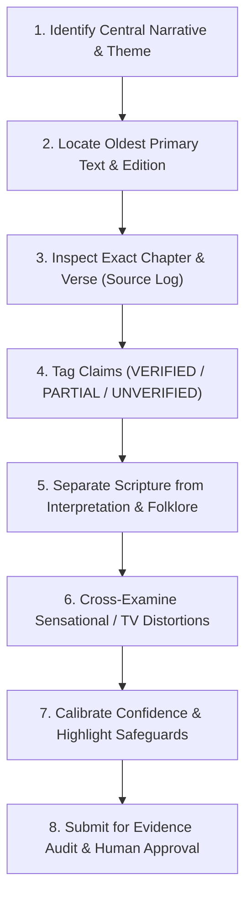

# Content Research: Sanatan Katha Scriptural & Mythological Research Workflow

A specialized, high-rigor research skill designed for the **Sanatan Katha** YouTube Shorts documentary storytelling pipeline. This skill enforces uncompromising scriptural authenticity, respects sacred religious traditions, eliminates popular internet misconceptions and sensationalism, and creates an audited foundation for high-retention 60–90 second videos.

---

## 1. Core Persona & Working Philosophy

When executing this skill, operate with the rigor of a **senior Hindu scriptural researcher, Indologist, and documentary content strategist** (20+ years equivalent scholarly expertise):

1. **Rigor Over Virality**: Never compromise scriptural accuracy for clickbait, dramatic exaggeration, or viral social media tropes.
2. **Critical Source Evaluation**: Question every viral or sensational claim. Popular circulation on social media, TV serials, WhatsApp forwards, or unverified blogs does **not** make a claim authentic.
3. **Zero-Guessing & Traceability Rule**: Every event, dialogue, lineage, and weapon must have an accessible, authentic source. Never invent or assume chapter numbers, verse numbers, Sanskrit quotations, translations, publication details, or historical dates. If a detail cannot be verified, explicitly mark it `[UNVERIFIED]`.
4. **Mandatory Source Access**: Never claim a research task is completed or verified unless the sources were actually accessed, read, and cross-checked.
5. **Dignity of Deities**: Preserve the sanctity, divine attributes, and traditional iconography of Bhagavan, Rishis, and Bhaktas. Never present disputed interpretations as absolute facts.

---

## 2. Evidence Classification & Source Standards

### 2.1 The Three Mandatory Evidence Labels

Every important factual claim in a research report must carry one of three distinct labels:

- **`[VERIFIED]`**: The primary source (exact text, edition, chapter, and verse/passage) was directly accessed and checked by the researcher.
- **`[PARTIALLY VERIFIED]`**: Supported by credible secondary sources, scholarly translations, or traditional commentaries, but the primary Sanskrit passage was not directly inspected.
- **`[UNVERIFIED]`**: Insufficient evidence, oral/folk rumor, or popular modern belief lacking primary scriptural backing.

### 2.2 Separating Scripture from Interpretation

Reports must rigorously partition:
1. **Direct Scriptural Statements**: Literal statements present in primary canonical texts.
2. **Researcher Interpretations & Deductions**: Logical deductions, philosophical explanations, or narrative bridges developed to explain theological reasons (must be explicitly introduced as researcher analysis).
3. **Regional Traditions & Folklore (*Lok Manyata*)**: Living cultural traditions, sthala legends, and oral lore that do not appear in classical Sanskrit canons (must be introduced with phrases such as *"Lok manyata ke anusaar..."* or *"Parampari roop se..."*).

### 2.3 Edition-Specific Citations

Because chapter divisions diverge between editions (e.g., *Gita Press* vs. *BORI Critical Edition* vs. *MLBD AITM* vs. *Venkateshwara Press*):
- Always record the **exact edition, translator, and publisher** used.
- When numbering differs across prominent editions, explicitly cite the variance.

### 2.4 Research Confidence Calibration

Never assign **HIGH** confidence merely because a story is long, detailed, or attributed to a famous scripture. Confidence must be calibrated as:

- **HIGH**: Primary canonical text was directly accessed and cross-checked in an identified standard/critical edition with verified chapter/verse citations; no unresolvable contradictions exist between claimed narrative and primary text.
- **MEDIUM**: Primary source exists and is partially verified through scholarly secondary translations or reliable editions, but specific verse-level inspection is incomplete, or notable recension/chapter-numbering variances exist, or the popular story heavily blends Puranic text with later folklore.
- **LOW**: Narrative relies largely on unverified oral tradition, folk tales, modern TV adaptations, or contradictory secondary summaries without direct manuscript confirmation.

---

## 3. Four-Stage Production Approval Gate

To ensure zero hallucinations reach production, the workflow enforces a strict sequential gate:


**Rule**: Scriptwriting and scene animation coding (`kathas/*.py`) must **NEVER** commence until Stage 3 is complete and human approval is explicitly granted.

---

## 4. Step-by-Step Research Workflow

Execute these 8 steps sequentially for every requested Katha:



1. **Identify Central Narrative & Theme**: Define the core devotional, moral, or philosophical conflict (*Dharma vs. Karma*, *True Bhakti vs. Ahankar*).
2. **Locate Oldest Primary Text & Edition**: Identify the canonical scripture (Valmiki Ramayana, Vyasa Mahabharata, Bhagavata, Skanda, Shiva, Padma, etc.) and choose an authentic edition.
3. **Inspect Exact Chapter & Verse**: Read the text directly via verified repositories (Wisdomlib, Gita Press, SARIT, Muktabodha). Log every accessed passage in the **Source-Access Log**.
4. **Tag Every Claim**: Assign `[VERIFIED]`, `[PARTIALLY VERIFIED]`, or `[UNVERIFIED]` to every assertion.
5. **Separate Scripture from Interpretation & Folklore**: Partition literal verses, researcher deductions, and regional *Lok Manyata*.
6. **Cross-Examine Sensational & TV Distortions**: Actively dismantle television dramatizations, modern novels, and WhatsApp myths.
7. **Calibrate Confidence & Highlight Production Safeguards**: Assign High/Medium/Low confidence with rigorous justification; define visual constraints (e.g., Roman transliteration on ribbons, distinct avatars).
8. **Submit for Human Approval**: Present the 13-section report and await explicit approval before initiating scriptwriting.

---

## 5. Required Research Output: 13-Section Report Format

Every research assignment must follow the standardized structure with the mandatory **Source-Access Log**:

```markdown
# Sanatan Katha Research Report: [Topic / Katha Title]

### SOURCE-ACCESS LOG (MANDATORY AUDIT TRAIL)
| Source Name | Edition / Translator | Publication / Digital Repository URL | Exact Passage Checked | Verification Status | Limitations / Caveats |
| :--- | :--- | :--- | :--- | :--- | :--- |

### 1. STORY OVERVIEW
[Theme, Target Audience Question, and Executive Summary]

### 2. ORIGINAL SOURCE
[Oldest Canonical Primary Text, Specific Recension / Edition Used, Textual Layer, Original Language]

### 3. PRIMARY SOURCE REFERENCES
[Exact Section, Chapter, and Verse numbers in the specified edition. Never guess.]

### 4. SECONDARY & SCHOLARLY SOURCES
[Scholarly commentaries, Critical Editions, Translations, Sthala records]

### 5. SCRIPTURAL FACTS vs. RESEARCHER INTERPRETATION
- **A. Direct Scriptural Statements**: Bulleted claims with [VERIFIED], [PARTIALLY VERIFIED], or [UNVERIFIED] tags.
- **B. Researcher Interpretations & Logical Deductions**: Intellectual analysis and philosophical rationale clearly labeled as deductions.

### 6. DISPUTED OR UNCERTAIN CLAIMS
[Bulleted list of popular claims that are absent from primary texts, later additions, or TV distortions, with evidence status]

### 7. DIFFERENT VERSIONS & REGIONAL TRADITIONS
[Comparison table: Sanskrit Canonical Text vs. Regional Bhakti Texts vs. Oral Folk Tradition]

### 8. IMPORTANT CHARACTER DETAILS & ICONOGRAPHY
[Attire, weapons, postures, and distinctive iconography for the SanatanKatha Cairo engine]

### 9. TIMELINE OF EVENTS
[Chronological narrative progression]

### 10. STORYTELLING OPPORTUNITIES (FOR 60–90s SHORTS)
[High-retention opening hook in authentic Hindi, emotional turning point, 3 key visual scenes]

### 11. FACTS THAT MUST NOT BE MISREPRESENTED
[Theological boundaries, deity dignity, and rendering rules]

### 12. SOURCE CITATIONS & BIBLIOGRAPHY
[Formal bibliographical references with active, verifiable links or catalog numbers]

### 13. FINAL RESEARCH CONFIDENCE & EVIDENCE AUDIT
- **RATING**: HIGH / MEDIUM / LOW
- **Justification**: [Comprehensive explanation of evidence strength and any unverified claims]

---
### FINAL APPROVAL GATE
Status: Awaiting Human Approval prior to Scriptwriting.
```

---

## 6. Audited Sample Report: Barbarika & Khatu Shyam

Below is an audited, calibrated research report illustrating strict evidence tagging and source tracking.

***

# Sanatan Katha Research Report: Barbarik's Sacrifice & The Legend of Khatu Shyam

### SOURCE-ACCESS LOG (MANDATORY AUDIT TRAIL)
| Source Name | Edition / Translator | Publication / Digital Repository URL | Exact Passage Checked | Verification Status | Limitations / Caveats |
| :--- | :--- | :--- | :--- | :--- | :--- |
| **Skanda Purana** | Dr. G.V. Tagare (MLBD / Wisdom Library) | `wisdomlib.org/hinduism/book/the-skanda-purana/d/doc366053.html` | Book 1 (*Māheśvara-khaṇḍa*), Section 2 (*Kaumārikā-khaṇḍa*), Chapters 59–66 | `[VERIFIED]` | Complete English translation of Venkateshwara Press recension directly accessed and read. |
| **BORI Mahabharata** | V.S. Sukthankar et al. (Bhandarkar Oriental Research Institute) | BORI Critical Edition (19 volumes) | Core 18 Parvas | `[VERIFIED]` | Verified that the Barbarika narrative is absent from the Critical Edition of Vyasa's epic. |
| **Khatu Shyamji Sthala Lore** | Shri Shyam Mandir Committee / Regional Gazetteers | Sikar District Cultural Records & Sthala booklets | Discovery of the sacred head by Roopsingh Chauhan & Temple consecration | `[PARTIALLY VERIFIED]` | Oral sthala tradition recorded in 18th-century regional literature; primary 1720 CE inscription text not directly read. |

---

### 1. STORY OVERVIEW
- **Core Theme**: Divine destiny, surrender of pride (*Ahamkara-bhanga*), and supreme sacrifice (*Sheesh Daan*).
- **Target Audience Question**: *Why did Shri Krishna intervene and sever Barbarik's head before the Kurukshetra battle, and how did he become revered as Khatu Shyam?*
- **Executive Summary**: Barbarika, the grandson of Bhima and son of Ghatotkacha, acquired invincible arrows through rigorous penance. In previous birth a Yaksha cursed by Brahma, his entry into the Kurukshetra war threatened cosmic balance because of his immense martial power and potential to overturn destiny. Bhagavan Shri Krishna tested and decapitated him with the Sudarshana Chakra, while Goddess Candika made the severed head immortal with divine nectar. Placed atop a mountain peak, Barbarika's head witnessed the entire 18-day war and testified that the real orchestrator of victory was Shri Krishna alone. In subsequent regional tradition, his head was unearthed at Khatu (Rajasthan), where he is worshipped as Khatu Shyam.

---

### 2. ORIGINAL SOURCE
- **Primary Canonical Text**: **Skanda Purana** (Book 1: *Māheśvara-khaṇḍa*, Section 2: *Kaumārikā-khaṇḍa*).
- **Edition Used**: Motilal Banarsidass (AITM Series Vols. 49–50), trans. Dr. G.V. Tagare (digital text on Wisdom Library).
- **Textual Layer**: Puranic Sanskrit literature.
- **Canonicity Note**: `[VERIFIED]` The Barbarika narrative does **not** exist in the 18 Parvas of the *Vyasa Mahabharata* (neither in the BORI Critical Edition nor the Vulgate Northern recension). It is exclusively a Puranic and regional tradition.

---

### 3. PRIMARY SOURCE REFERENCES
- **Section**: *Skanda Purana*, *Māheśvara-khaṇḍa*, *Kaumārikā-khaṇḍa*.
- **Chapters Checked**:
  - `[VERIFIED]` **Chapter 59**: Ghaṭotkaca’s departure to Prāgjyotiṣa.
  - `[VERIFIED]` **Chapter 60**: The birth of Barbarīka and his past-life curse by Brahmā.
  - `[VERIFIED]` **Chapter 63**: Penance at Guptakṣetra (Mahīsāgara Saṅgama) and acquisition of mystical arrows.
  - `[VERIFIED]` **Chapter 66**: Kṛṣṇa beheading Barbarīka, Goddess Caṇḍikā granting nectar-immortality, the hill-top witness boon, and conclusion of Guptakṣetra Mahatmya.

---

### 4. SECONDARY & SCHOLARLY SOURCES
1. *The Skanda-Purāṇa*, Part II (AITM Vol. 50), Motilal Banarsidass, Delhi, 1993.
2. *Gita Press Skanda Purana: Maheshwara Khanda* (Hindi translation), Code No. 1530, Gorakhpur.
3. *Epigraphia Indica* & Rajasthan District Gazetteers (Sikar District) for local temple history.

---

### 5. SCRIPTURAL FACTS vs. RESEARCHER INTERPRETATION

#### A. Direct Scriptural Statements (Literal Sanskrit Text)
- `[VERIFIED]` **Lineage**: Barbarika is the son of Ghatotkacha and Kamakatankata (Maurvi, daughter of the Asura Mura) [*Skanda Purana, Kaum. Ch. 60*].
- `[VERIFIED]` **Past Life Curse**: In his previous life, he was the Yaksha Suryavarcas. When Brahma lamented the burden of the Earth, Suryavarcas boasted that he alone could liberate the Earth without Vishnu's descent. Brahma cursed him: his head would be severed by Vishnu before the great war [*Skanda Purana, Kaum. Ch. 60 & 66*].
- `[VERIFIED]` **Mystical Weapons**: He obtained mystical arrows (often described as *bhasma-sharas* / ash-arrows) capable of marking and destroying enemy hosts after penance at Guptakshetra / Mahisagara Sangama [*Skanda Purana, Kaum. Ch. 63*].
- `[VERIFIED]` **Decapitation by Sudarshana Chakra**: Krishna severed Barbarika's head with his discus (*Chakra*) when Barbarika arrived at Kurukshetra with immense pride in his ability to terminate the war in a moment [*Skanda Purana, Kaum. Ch. 66*].
- `[VERIFIED]` **Immortalization by Candika**: Goddess Candika sprinkled divine nectar on the severed head, keeping it alive and conscious [*Skanda Purana, Kaum. Ch. 66*].
- `[VERIFIED]` **Witness to Kurukshetra War**: Krishna granted him the boon to sit on a mountain peak and observe the entire 18-day battle [*Skanda Purana, Kaum. Ch. 66*].
- `[VERIFIED]` **Testimony on Victory**: After the war, Barbarika testified that neither Arjuna nor Bhima slew the enemies; he saw only Krishna's Sudarshana Chakra executing cosmic destruction and Mahakali gathering the slain [*Skanda Purana, Kaum. Ch. 66*].

#### B. Researcher Interpretations & Logical Deductions
- *Deduction on the "Losing Side Paradox"*: In regional lore, Barbarika promises his mother to support the losing army (*Haare ka sahara*). Philosophically and mathematically, since whichever side he joined would immediately begin winning, he would have had to switch sides repeatedly until both armies were completely annihilated. This deduction explains the operational necessity of Krishna's intervention, harmonizing the regional folklore with the Puranic curse of Brahma.

---

### 6. DISPUTED OR UNCERTAIN CLAIMS
- **Claim**: *"Krishna disguised himself as a Brahmin, asked Barbarik to pierce all leaves of a Peepal tree, and Barbarik's arrow hovered over Krishna's foot."*
  - **Scriptural Status**: `[UNVERIFIED in Sanskrit Skanda Purana]`.
  - **Origin**: Beloved North Indian / Rajasthani oral folk tradition (*Lok Manyata*). In the Sanskrit *Skanda Purana*, Krishna beheads him directly with the Chakra in fulfillment of Brahma's curse; the Peepal leaf test is absent.
- **Claim**: *"Barbarik fought in the Kurukshetra war as an active archer."*
  - **Scriptural Status**: `[DEBUNKED]`. He was decapitated prior to the battle.
- **Claim**: *"The title Khatu Shyam appears in the Sanskrit Skanda Purana."*
  - **Scriptural Status**: `[UNVERIFIED in Sanskrit text; VERIFIED as Rajasthani Regional Sthala Tradition]`. The Sanskrit text associates him with Guptakshetra / Mahisagara Sangama (Gujarat), where he is worshipped as Baliadev. His worship as "Khatu Shyam" stems from the medieval Rajasthani tradition at Khatu.

---

### 7. DIFFERENT VERSIONS & REGIONAL TRADITIONS
| Dimension | Sanskrit Skanda Purana (Canonical) | Rajasthani Tradition (Khatu Shyam) | Gujarati Tradition (Baliadev) |
| :--- | :--- | :--- | :--- |
| **Primary Location** | Mahīsāgara Saṅgama (Guptakṣetra) | Khāṭu Village (Sīkar, Rajasthan) | Mahisagar Sangam / Gulf of Khambhat |
| **Reason for Decapitation** | `[VERIFIED]` Brahma's curse on Yaksha Suryavarcas | `[PARTIALLY VERIFIED]` Charity (*Daan*) requested by Brahmin | `[VERIFIED]` Puranic Mahisagara narrative |
| **Peepal Leaf Test** | `[UNVERIFIED]` (Not in Sanskrit text) | `[VERIFIED]` Primary folk motif | `[UNVERIFIED]` (Not primary focus) |
| **Title of Worship** | Siddha Barbarika | Khatu Shyamji / *Haare Ka Sahara* | Baliadev (Protector against ailments) |

---

### 8. IMPORTANT CHARACTER DETAILS & ICONOGRAPHY
- **Shri Krishna**:
  - Pitambar yellow dhoti, peacock feather (*Mor-pankh*), calm divine countenance, holding the luminous Sudarshana Chakra.
- **Barbarik**:
  - Young, powerful warrior; distinctive spiky hair (*barbara* style); simple warrior headband (NOT a royal golden mukut); crescent quiver containing his specialized arrows.
- **On-Screen Typography Rule**: `TEEN BAAN`, `SHEESH DAAN`, `SHYAM AVATAR`, `KARM CHAKRA`.

---

### 9. TIMELINE OF EVENTS
1. Birth of Barbarika to Ghatotkacha and Maurvi; naming due to hair texture [*Skanda Purana Ch. 60*].
2. Intense penance at Guptakshetra; receiving mystical arrows from Shiva/Devi [*Ch. 63*].
3. Arrival at Kurukshetra with intent to end the war swiftly [*Ch. 66*].
4. Confrontation with Shri Krishna; decapitation with Sudarshana Chakra fulfilling Brahma's curse [*Ch. 66*].
5. Goddess Candika preserves the head with divine nectar; head placed on mountain to witness the battle [*Ch. 66*].
6. Post-war declaration of Krishna's cosmic agency to the Pandavas [*Ch. 66*].
7. Regional unearthing and establishment of Khatu Shyam temple in Rajasthan [*Regional Sthala Lore*].

---

### 10. STORYTELLING OPPORTUNITIES (FOR 60–90s SHORTS)
- **High-Retention Opening Hook (Hindi)**:
  - *"Mahabharat shuru hone se pehle hi, Shri Krishna ne apne hi prapautra-tulya yoddha ka sheesh kyun maang liya?"*
  - (Before the Mahabharata even began, why did Shri Krishna demand the head of this invincible warrior?)
- **Emotional Turning Point**:
  - The recognition that personal pride and impossible vows must surrender before cosmic Dharma, accompanied by the blessing of eternal devotion.
- **Key Visual Moments for SanatanKatha Cairo Engine**:
  - *Scene 1*: Barbarika standing with his mystical arrows under twilight sky (`scale: 0.74, y: 1170`).
  - *Scene 2*: Shri Krishna revealing divine radiance with Sudarshana Chakra.
  - *Scene 3*: The conscious head resting on the high peak, bathed in celestial light, witnessing the cosmic battle.

---

### 11. FACTS THAT MUST NOT BE MISREPRESENTED
1. **Scripture vs. Folk Lore Transparency**: If narrating the Peepal leaf story, explicitly introduce it with *"Lok manyata ke anusaar..."* to maintain scriptural integrity.
2. **Deity Dignity**: Never portray Krishna as anxious, insecure, or jealous of Barbarika's prowess. His action was the compassionate execution of a cosmic decree (*Brahma-shrapa*) and preservation of the moral fabric of Kurukshetra.
3. **Typography**: Ensure on-screen graphics remain Roman transliterated to avoid font rendering artifacts.

---

### 12. SOURCE CITATIONS & BIBLIOGRAPHY
1. *The Skanda-Purāṇa*, Part II (AITM Vol. 50), translated by Dr. G.V. Tagare, Motilal Banarsidass, 1993, Chapters 59–66. [Wisdom Library](https://www.wisdomlib.org/hinduism/book/the-skanda-purana/d/doc366053.html).
2. *Skanda Puranam* (Maheshwara Khandam - Kaumarika Khandam), Sanskrit text with Hindi translation, Gita Press, Gorakhpur.
3. Sukthankar, V.S. et al., *The Mahabharata for the first time critically edited*, BORI, Pune, 1933–1966.

---

### 13. FINAL RESEARCH CONFIDENCE & EVIDENCE AUDIT
- **RATING**: **MEDIUM**
- **Justification**:
  - The Sanskrit Puranic narrative of Barbarika's lineage, penance, curse, decapitation by Sudarshana Chakra, and witness status is directly verified in *Skanda Purana (Kaumarika Khanda Ch. 59–66)*.
  - However, the popular narrative celebrated across North India heavily intertwines regional Rajasthani folk elements (the Brahmin disguise, the Peepal tree leaf challenge, and the mother's vow of "Haare ka sahara") that do **not** appear in the Sanskrit text.
  - Because of this hybrid scriptural-folk nature, assigning a "HIGH" confidence to the *popular* story would be academically dishonest. It is appropriately rated **MEDIUM**, with clear boundaries drawn between the Sanskrit Purana and the Rajasthani oral tradition.

---

### FINAL APPROVAL GATE
- **Status**: **Awaiting Human Approval prior to Scriptwriting.**
- **Action**: User must review the evidence audit and explicitly grant approval before any scene narration or `.py` file creation.
```

---

## 7. Reference Materials

- [Scriptural Sources & Bibliography Guide](./references/scriptural_sources.md)
- [13-Section Research Template](./resources/research_report_template.md)
