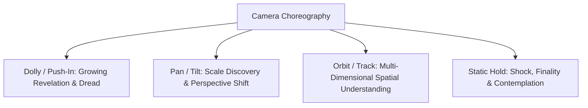

# RealityShift: Camera Movement, Composition & 9:16 Framing

This reference guide establishes the camera language, vertical composition rules, shot types, movement choreography, and safe-zone specifications for 9:16 YouTube Shorts in the RealityShift pipeline.

---

## 1. The 9:16 Vertical Composition Challenge & Safe Zones

Standard cinematography rules developed for 16:9 or 2.39:1 widescreen fail in vertical video. A 9:16 canvas is a **vertical column ($1080 \times 1920\text{ px}$)**, requiring distinct composition techniques.

### 1.1 Safe Zone Comparison: Existing Renderer vs. Proposed Cinematic Standard

To ensure seamless production without assuming unverified engine features, director blueprints must distinguish between the **existing RealityShift renderer boundaries** and the **proposed cinematic composition guidelines**:

```text
+-----------------------+ y = 0
| Top Header Margin     | (y = 0 - 180) YouTube header & search bar
+-----------------------+
| HUD Ribbon Safe Band  | (y = 280 - 380) Single sleek Roman HUD tag
+-----------------------+
|                       |
|   PRIMARY FOCAL ZONE  | (y = 380 - 1150)
|  The central 770px    | All critical subjects, planetary horizons,
|  where viewer eyes    | and primary actions must live here.
|  naturally rest       |
|                       |
+-----------------------+
| Kinetic Caption Band  | Existing lego.py: y = 1150 - 1250 (100px band)
|                       | Proposed cinematic target: y = 1150 - 1320 (expanded for dynamic captions)
+-----------------------+
| Bottom Danger Zone    | Existing lego.py UI_CLEAR: y > 1520 (bottom 400px dark/clear)
| (Keep dark / empty)   | Proposed conservative margin: y > 1450 (bottom 470px clear for mobile rail)
+-----------------------+ y = 1920
```

> [!NOTE]
> **Renderer Safe-Zone Compatibility Note**: The legacy pipeline (`story-pipeline/RealityShift/core/lego.py`) defines `CAP_TOP, CAP_BOTTOM = 1150, 1250` and `UI_CLEAR = 1520`. Expanding the caption band to $y = 1150 - 1320$ or tightening the bottom clear margin to $y > 1450$ is a **proposed recommendation for Skill 4 (`rs-video-implementation`)**, not an assumed feature of the legacy codebase.

### 1.2 Vertical Composition Rules
1. **Vertical Leading Lines**: Exploit vertical perspective—towering orbital elevators, vertical light pillars, deep oceanic trenches, or planetary limbs cutting diagonally across the frame.
2. **Never Crop 16:9 Blindly**: Do not frame a wide shot and crop the sides; wide cosmic vistas in 9:16 must be composed with vertical breathing room (e.g. Earth resting in the lower half with deep starfields towering above).
3. **The Danger Zone ($y > 1450 / 1520$)**: Never place human faces, key planetary objects, or critical text below $y = 1450$. Keep this bottom region filled with dark, non-essential textures (ocean base, shadow, space void).

---

## 2. Standardized Shot Types

| Shot Code | Name | Framing & Coverage in 9:16 | Narrative Purpose |
| :--- | :--- | :--- | :--- |
| **EWS** | Extreme Wide Shot | Entire planet or celestial system filling $\le 40\%$ of frame height; massive cosmic void around it. | Establishes staggering scale, vulnerability, and cosmic isolation. |
| **WS** | Wide Shot | Full subject visible (e.g., Earth filling $60-70\%$ of width, or a coastal metropolis skyline). | Establishes environment, geography, and systemic context. |
| **MS** | Medium Shot | Human waist-up, or a localized regional landscape (e.g., harbor docks with stranded boats). | Connects celestial events to human / terrestrial scales. |
| **CU** | Close-Up | A human face, a specific technical instrument, or a localized planetary storm system. | Heightens emotion, tension, and sensory immediacy. |
| **ECU** | Extreme Close-Up | Human eye, single data terminal readout, or tidal mudflat crack. | Delivers intense shock, precision detail, or climactic focus. |

---

## 3. Camera Movements & Storytelling Motivations

Movement in RealityShift must always be **motivated by physics or narrative tension**, never random shakiness:



### 3.1 Push-In (Slow Dolly In)
- **Visual Feel**: Camera moves smoothly forward along the Z-axis toward the subject.
- **Narrative Motivation**: Draws the viewer into a terrifying revelation, intensifies focus on a collapsing object, or underscores an existential paradox.
- **Speed**: Ultra-slow ($0.5\% - 1.5\%$ scale increase per second) to preserve awe.

### 3.2 Pull-Back (Dolly Out / Reveal)
- **Visual Feel**: Camera moves backward, expanding the field of view.
- **Narrative Motivation**: Reveals that a localized crisis is part of a colossal cosmic system; pulls back from a city to show the entire unshielded planet.

### 3.3 Vertical Tilt (Pedestal Up / Down)
- **Visual Feel**: Camera travels strictly along the Y-axis.
- **Narrative Motivation**: Capitalizes on the 9:16 vertical canvas—tilts from dark, stranded harbor mudflats up into a moonless starlit sky.

### 3.4 Orbital Drift (Fly-Around)
- **Visual Feel**: Camera arcs in a partial orbit around a celestial body or technological core.
- **Narrative Motivation**: Reveals 3D spherical depth, lighting transitions across the day/night terminator line, or axial tilt wobbles.

### 3.5 The Static Hold
- **Visual Feel**: Completely locked-off camera with zero movement.
- **Narrative Motivation**: Deployed immediately after a shocking announcement (e.g. the first moment the Moon vanishes). Movement would dilute the shock; stillness forces the viewer to confront the void.

---

## 4. Layered Depth: Foreground, Midground & Background

Every 9:16 frame must be constructed in three distinct spatial planes to create a cinematic 3D feel on a flat smartphone screen:

1. **Foreground (FG)**:
   - Silhouette of an astronaut's visor edge, a rocky cliff overhang, coastal promenade railing, or technical HUD reticle.
   - Moves fastest during camera translation, creating strong parallax.
2. **Midground (MG)**:
   - The primary narrative subject (e.g. Earth, descending spacecraft, tidal mudflat).
   - Sharpest focus, key light exposure.
3. **Background (BG)**:
   - The Milky Way core, distant starfield, deep space void, or glowing solar corona.
   - Moves slowest, anchoring spatial orientation.

---

## 5. Technical Tool Feasibility & Implementation Boundaries

When directing shots, distinguish what current tools can reliably achieve versus what requires complex multi-step VFX:

| Camera Movement | Feasibility via AI Video (Runway Gen-3 / Luma / Kling) | Feasibility via 2.5D Motion (MoviePy / FFmpeg Pan-Zoom) | Recommended Pipeline Path |
| :--- | :--- | :--- | :--- |
| **Slow Push-In / Zoom** | High (native camera control) | Excellent (100% reliable mathematically via Ken Burns script) | Standard default for tension build |
| **Vertical Pan / Tilt** | High | Excellent (via vertical canvas pan) | Excellent for 9:16 scale reveals |
| **Complex 360° Orbit** | Medium (can hallucinate background details) | Low (requires 3D projection / depth map) | Mark as *Complex: Requires AI Video or Multi-Frame Sync* |
| **Fluid Water Simulation** | Medium-Low (AI video often morphs water unnaturally) | Medium (requires layered video overlay or static drone shot) | Use high-angle drone shot with subtle surface shimmer |
| **Hard Space Physics** | Low (AI video engines often invent cartoon motion) | High (composite static photorealistic planet with programmatic rotation) | Composite static AI image + motion engine |

---

## 6. Typography & Font Verification Guidelines

The existing RealityShift engine and Cairo compositor reference fonts like `Impact`, `Consolas`, and `Segoe UI Bold`. When specifying typography for HUD and caption overlays:
- **Verified Host Availability**: On Windows, `impact.ttf`, `consola*.ttf`, and `segoeui*.ttf` are installed locally in `C:\Windows\Fonts`.
- **Cross-Platform Fallbacks**: On non-Windows platforms (e.g. Linux rendering servers, Docker containers), proprietary Windows fonts are not guaranteed. The director must document fallback font candidates:
  - *Primary (Windows)*: `Impact` (captions), `Consolas` (HUD monospaced), `Segoe UI Bold` (UI cards).
  - *Fallback (Linux/Cross-Platform)*: `Liberation Sans Bold`, `DejaVu Sans Bold`, `Courier New`.
  - Skill 4 must verify font resolution at runtime and fall back gracefully without failing renders.
