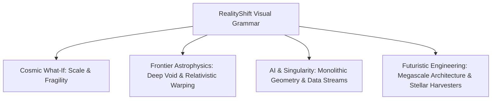

# RealityShift: Cinematic Visual Language & Aesthetic Framework

This reference guide establishes the visual grammar, cinematography rules, lighting standards, and color science for the RealityShift (@RealityShiftByAnkit) production pipeline.

---

## 1. Visual Storytelling Philosophy

In high-concept science communication, visuals must not simply decorate spoken narration; they must **reveal the physical mechanism, convey staggering cosmic scale, and evoke existential wonder**:

1. **Every Shot Has a Storytelling Purpose**: Never include a visual merely because it looks "cool". Every frame must communicate a specific physical state, scale comparison, or narrative turning point.
2. **Scale as an Emotional Driver**: Human viewers cannot intuitively grasp a distance of $384,400\text{ km}$, a mass of $10^{24}\text{ kg}$, or a timeline of $10^8\text{ years}$. The visual language must anchor celestial scale against relatable human frames (e.g. human silhouetted against a low-tide harbor, towering skyscraper under a darkening sky, thin blue ribbon of atmosphere against the endless void).
3. **Escalating Visual Intensity**: Start with cold, pristine scientific observation $\to$ transition to sudden sensory shock $\to$ escalate to planetary/civilizational realignment $\to$ culminate in awe-inspiring cosmic contemplation.

---

## 2. Pillar-Specific Visual Grammar

### 2.1 Pillar 1: Cosmic 'What If' Scenarios
- **Core Aesthetic**: Planetary photorealism, astronomical scale contrast, environmental dynamism.
- **Lighting**: Stark, unshielded directional sunlight contrasted with the dead-black vacuum of space; atmospheric twilight scattering; soft earthshine on lunar regolith.
- **Mood**: Fragile, precious, dangerous, breathtaking.

### 2.2 Pillar 2: Frontier Astrophysics & Deep Space
- **Core Aesthetic**: Ethereal, mysterious, mathematically terrifying, relativistic.
- **Lighting**: Accretion disk Doppler beaming (asymmetric blue/redshifted luminosity), gravitational lensing halos, Cherenkov radiation glows, cold pulsar beams cutting through nebular dust.
- **Mood**: Deep cosmic isolation, mind-bending physics, awe.

### 2.3 Pillar 3: Artificial Intelligence & The Singularity
- **Core Aesthetic**: Stark, minimalist, hyper-dense hardware, silent processing, monolithic scale.
- **Lighting**: Deep cryogenic obsidian, subtle fiber-optic pulses, clean white laser interlinks, sterile cleanrooms, server corridors stretching into infinity.
- **Mood**: Incomprehensible speed, non-biological optimization, cold inevitability.

### 2.4 Pillar 4: Futuristic Mega-Engineering & Paradoxes
- **Core Aesthetic**: Megastructure realism, industrial geometry, orbital mechanics, dyson swarms.
- **Lighting**: Blinding solar corona backlighting, metallic specular gleams across million-kilometer orbital rings, planetary shadow transits.
- **Mood**: Boundless human ambition, colossal engineering triumph.

---

## 3. Color Science & Palette Calibration

To maintain visual cohesion, RealityShift utilizes four standardized master color palettes:

### Palette Alpha: "Deep Space Obsidian" (Cosmic & Planetary)
- **Primary Void**: `#04060B` (Cold space obsidian)
- **Planetary Surface**: `#1A4B75` (Oceanic sapphire) / `#8F6E4C` (Continental terra-cotta)
- **Atmospheric Glow**: `#38B6FF` (Rayleigh scattering rim light)
- **Solar Key Light**: `#FFF3D1` (Unfiltered harsh sunlight)
- **Alert / Anomaly Accent**: `#FF3B30` (Crimson hazard vector)

### Palette Beta: "Event Horizon" (Relativistic Astrophysics)
- **Void Base**: `#020204` (Pure singularity black)
- **Accretion Core**: `#FF9E1B` (Incandescent plasma orange)
- **Relativistic Shift**: `#446BFF` (Blueshifted plasma) to `#A01A00` (Redshifted limb)
- **Gravitational Halo**: `#E8F0FE` (Lensed starlight)

### Palette Gamma: "Quantum Singularity" (AI & High Tech)
- **Base Structure**: `#0A0D14` (Cryogenic slate)
- **Logic Glow**: `#00F0FF` (Cyan optical coherence)
- **Neural Interlink**: `#7B2CBF` (Deep quantum violet)
- **Hazard State**: `#FF0055` (Alignment breach magenta)

### Palette Delta: "Dyson Specular" (Futuristic Engineering)
- **Solar Surface**: `#FFAA00` (Turbulent solar granulation)
- **Alloy Framework**: `#2A2D34` (Tungsten-carbon composite)
- **Photovoltaic Gleam**: `#D4AF37` (Specular gold reflection)
- **Thruster Plume**: `#00D2FF` (Ion propulsion cyan)

---

## 4. Lighting & Atmospheric Depth

1. **Three-Point Planetary Lighting**:
   - **Key Light**: The Sun. Directional, ultra-sharp shadows, zero diffusion in vacuum.
   - **Fill Light**: Planetshine (reflected earthlight or moonshine) providing faint, colored illumination to unlit hemispheres.
   - **Rim Light**: Thin atmospheric limb glow or solar backlighting highlighting planetary curvature.
2. **Atmospheric Perspective (Ground Shots)**:
   - Use multi-layer depth: crisp high-contrast foreground $\to$ desaturated, hazy midground $\to$ deep atmospheric sky.
   - Avoid flat digital voids: incorporate realistic micro-particles (starlight dust, sea spray, atmospheric twilight mist).

---

## 5. Visual Effects (VFX) Hierarchy & Restraint

Overusing VFX produces cheap, distracting slop. Follow this strict hierarchy:

| VFX Element | Permitted Purpose | Prohibited Usage |
| :--- | :--- | :--- |
| **Film Grain** | Subtle 35mm grain (ISO 200-400) to blend digital AI renders into cinematic photorealism. | Heavy, noisy digital static that obscures small-screen mobile details. |
| **Volumetric Rays** | Low-angle sunlight piercing clouds, dust, or water to establish three-dimensional depth. | Excessive "god rays" in a vacuum where there is no medium to scatter light. |
| **Lens Flare** | Subtle anamorphic streak or circular flare when the Sun or intense plasma enters frame edges. | Giant multi-colored sci-fi flares that block the central narrative subject. |
| **Motion Blur** | Natural 180° shutter blur on fast-moving celestial bodies, debris, or camera pans. | Artificially smeared blur that hides poor generation quality. |
| **Chromatic Aberration**| Minimal optical edge fringing on ultra-wide lenses to mimic physical camera glass. | Heavy RGB splitting that makes text or HUD elements unreadable. |

