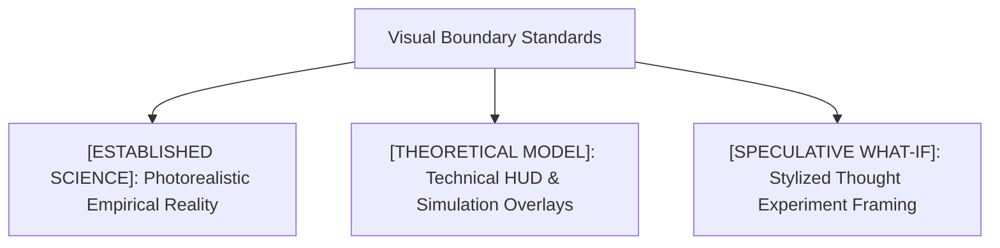

# RealityShift: Scientific Visual Accuracy & Visual Fact-Checking

This reference guide establishes the protocols for ensuring visual scientific truth, eliminating deceptive Hollywood tropes, and preserving physical rigor in visual prompts and animations for RealityShift (@RealityShiftByAnkit).

---

## 1. Visualizing the Three-Tier Reality Boundary

Just as narration in `rs-script-writer` strictly delineates scientific certainty, the visual direction must visually communicate the epistemological status of every scene:

1. **`[ESTABLISHED SCIENCE]` Visuals**:
   - Depict with uncompromising physical realism (e.g. authentic NASA/ESA lunar surface textures, correct Earth atmospheric limb thickness $\approx 100\text{ km}$ relative to Earth's $12,742\text{ km}$ diameter, Rayleigh scattering colors).
2. **`[THEORETICAL MODEL]` Visuals**:
   - Must incorporate clear visual cues indicating simulation or mathematical projection (e.g. vector arrows, orbital path lines, coordinate grids, wireframe overlays, or HUD text like `// SIMULATION MODEL`).
3. **`[SPECULATIVE WHAT-IF]` Visuals**:
   - Explicitly framed as thought experiments. For example, when depicting the disappearance of the Moon, the dissolution must look like an illustrative conceptual transition (fading starlight/vapor), **never** as a physical asteroid collision or nuclear detonation unless the script specifies that physical cause.

---

## 2. Eliminating Unscientific Hollywood Tropes

Visual prompts and director notes must explicitly prohibit these common sci-fi visual inaccuracies:

| Popular Hollywood Trope | Scientific Physical Reality | RealityShift Visual Direction Rule |
| :--- | :--- | :--- |
| **Instant Mega-Tsunami or Universal Ocean Drainage** | Removing lunar tidal forcing does not instantly stop ocean motion or drain all coasts. The ocean responds dynamically over hours and days as the tidal bulge subsides and water sloshes through ocean basins according to local bathymetry and resonance. Solar tidal forcing continues. | **NEVER** depict a giant breaking wave drowning cities or universal instantaneous ocean drainage. Depict localized low-tide settings as illustrative vignettes showing altered tidal rhythms, explicitly labeled `[ILLUSTRATIVE VIGNETTE]`. |
| **Earth Jolt / Barycenter Collapse** | The Earth-Moon barycenter is a mathematical center of mass ($4,670\text{ km}$ from Earth's core). Earth does not physically shake or lurch. | **NEVER** show Earth violently shaking, cracking, or lurching in space when the Moon vanishes. |
| **Instant 85° Planetary Somersault / Precession Confusion** | Numerical integrations (Lissauer et al. 2012) show that under modeled moonless conditions, the extent of obliquity (axial tilt) variation typically spans $\approx 20^\circ - 25^\circ$ over hundreds of millions of years. This is distinct from gyroscopic precession and does not mean an immediate axis shift or inevitable 85° flip (Laskar et al. 1993). | Depict obliquity variation as a slow, model-based variation in the tilt angle over deep time with technical HUD vectors, clearly labeled as a theoretical simulation, **not** an immediate axis shift, not an absolute tilt angle, and not an inevitable 85° tumble. |
| **Explosions with Fire & Smoke in Space** | Vacuum lacks atmospheric oxygen; explosions flash instantly and expand in invisible kinetic shrapnel. | Show silent, blinding white flashes with rapidly dispersing kinetic debris; no billowing terrestrial fireballs. |
| **Dense Asteroid Belts** | Asteroids are separated by an average of 1 to 3 million kilometers. | Show vast, terrifying, empty space with a single massive asteroid looming; no video-game obstacle courses. |
| **Black Hole as a 2D Whirlpool** | Black holes are 3D spherical horizons with light bent from behind by gravitational lensing, creating a double-ring halo. | Depict mathematically accurate Kerr/Schwarzschild gravitational lensing with Doppler-beamed accretion halos. |

---

## 3. Scale Compression: Honest Artistic Simplification

In celestial mechanics, true scale often renders objects invisible on a smartphone screen:
- *True Scale Reality*: The Moon ($3,474\text{ km}$) is approximately $30\text{ Earth diameters}$ away from Earth ($384,400\text{ km}$). At true scale, if both are in a single 9:16 vertical frame, both appear as tiny, indistinct marbles.
- *Artistic Scale Compression Protocol*:
  1. When Earth and Moon must share a single dramatic frame, the distance may be compressed artistically for visual storytelling.
  2. **Mandatory Documentation**: The cinematic direction blueprint must explicitly flag this shot: `[ARTISTIC SCALE COMPRESSION: Earth-Moon distance compressed for narrative readability]`.
  3. When presenting quantitative comparisons in subsequent shots, switch back to true perspective to preserve educational integrity.

---

## 4. Visualizing Invisible Forces (Gravity, Tides, Obliquity)

Because gravitational fields and orbital dynamics are invisible to the naked eye, the director must use **scientifically grounded illustrative visualizations**:
- **Gravitational Field Lines**: Elegant, translucent blue-white vector contours indicating gravitational potential wells (resembling General Relativity spacetime curvature).
- **Tidal Forcing Vectors**: Subtle, dual-bulge gravitational arrows indicating differential gravitational pull on Earth's oceans.
- **Obliquity Variation Vectors**: Translucent amber vectors showing the slow secular change in the axial tilt angle $\varepsilon$ across a modeled extent ($\Delta \varepsilon \sim 20^\circ - 25^\circ$), explicitly distinguished from gyroscopic precession cones around the orbit normal.
