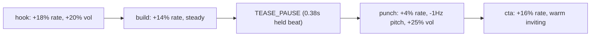

# Conversational Hindi & Voiceover Pacing Guide for RealityShift

This reference document establishes the language standards, pronunciation safety rules, numerical guidelines, and acoustic delivery conventions for writing voiceover scripts for RealityShift (@RealityShiftByAnkit).

---

## 1. The RealityShift Storytelling Identity

RealityShift speaks in the voice of an **intelligent, enthusiastic, and evidence-grounded science communicator**:
- **Not a dry academic lecturer**: Avoid stiff textbook prose and archaic Sanskrit vocabulary.
- **Not a sensationalist tabloid**: Avoid hysterical clickbait and fake melodrama.
- **Natural, intelligent Hindi**: Clear, fluid phrasing that an inquisitive viewer speaks, understands, and ponders.

```text
[OVERLY SANSKRITIZED / TEXTBOOK] ❌
"सौरमंडल के इस महाविनाशक आकाशीय पिंड के गुरुत्वाकर्षण खिंचाव से पृथ्वी की कक्षा में विक्षोभ उत्पन्न होगा।"

[OVERLY SLOPPY / CASUAL SLANG] ❌
"Guys, imagine karo agar ye asteroid hamare planet se collide ho jaye toh scene kitna crazy ho jayega!"

[REALITYSHIFT CONVERSATIONAL CLARITY] ✅
"सोचिए अगर ये विशाल एस्टेरॉयड अचानक धरती की दिशा में मुड़ जाए... तो सिर्फ चौबीस घंटे में हमारा आसमान आग का समंदर बन जाएगा!"
```

---

## 2. Preventing TTS Accent Glitches (KikiVoice & Indic Neural Engines)

Indic neural TTS engines (such as KikiVoice and Microsoft `hi-IN-MadhurNeural`) encounter severe accent distortion when unvetted English words or Latin script characters are embedded directly into Hindi text. The synthesizer often abruptly switches registers to an unnatural, clipped Western accent.

### 2.1 Pronunciation Safety Table

| Term Category | Raw English Word (Prone to Glitch) | Safe Spoken Form in Devanagari | Conversational Hindi Alternative |
| :--- | :--- | :--- | :--- |
| **Space & Tech** | `Satellite` | `सैटेलाइट` | `खोजी उपग्रह` |
| | `Computer simulation` | `कंप्यूटर सिमुलेशन` | `कंप्यूटर मॉडल` |
| | `Gravity` | `ग्रेविटी` | `गुरुत्वाकर्षण` |
| | `Black Hole` | `ब्लैक होल` | `अंतरिक्ष का ब्लैक होल` |
| | `Light speed` | `लाइट स्पीड` | `रोशनी की रफ्तार` |
| | `Atmosphere` | `एटमॉस्फियर` | `हमारा वायुमंडल` |
| | `Tsunami` | `सुनामी` | `समुद्री लहरें` |
| | `Tidal constituent` | `टाइड` | `ज्वार-भाटा` |
| **Channel Actions** | `Comment below` | `कमेंट में बताइए` | `अपनी राय कमेंट में लिखें` |
| | `Subscribe` | `सब्सक्राइब ज़रूर करें` | `चैनल से ज़रूर जुड़ें` |

> [!IMPORTANT]
> **Mandatory Audio Testing Rule**: Pronunciation safety guidelines provide initial best-practice guidance. However, **actual pronunciation in KikiVoice must always be auditioned with test audio before final video rendering**. Never assume a synthesized line is flawless without listening to it.

---

## 3. Writing Numbers, Measurements, Decimals, Dates & Units for Speech

Do **not** force every single number into long Hindi words if it produces awkward or clunky phrasing. Follow these practical spoken guidelines:

### 3.1 Astronomical & Large Scales
- Large vernacular quantities sound natural when combining digits with Indian numbering scales:
  - Write `4 लाख किलोमीटर` (spoken as "chaar lakh kilometer").
  - Write `4.5 अरब साल` (spoken as "saadhe chaar arab saal").
  - Write `24 घंटे` or `चौबीस घंटे` (spoken naturally as "chaubees ghante").

### 3.2 Decimals & Fractions
- Colloquial fractions often sound far more natural than mechanical decimal readings:
  - $1.28\text{ seconds}$ $\to$ `सवा सेकंड` (spoken: "sawa second") or `लगभग 1.3 सेकंड` ("lagbhag ek point teen second").
  - $1.5\text{ hours}$ $\to$ `डेढ़ घंटा` ("dedh ghanta").
  - $2.5\text{ times}$ $\to$ `ढाई गुना` ("dhai guna").

### 3.3 Ranges & Degrees
- For temperature or angular ranges, keep digits clear:
  - Write `20 से 25 डिग्री` (spoken: "bees se pachchis degree").
  - Write `85 डिग्री` (spoken: "pachasi degree").

### 3.4 Dates & Years
- Four-digit years should read as conversational Hindi numbers:
  - `1993` $\to$ `उन्नीस सौ तिरानवे` ("unnis sau tiranve") or spoken in script context as `1993 ke ek adhyayan mein`.
  - `2012` $\to$ `दो हज़ार बारह` ("do hazaar baarah").

### 3.5 Abbreviations & Acronyms
- Standard scientific acronyms should be written phonetically so the synthesizer does not spell them out letter-by-letter as separate clipped syllables:
  - Write `नासा` (for NASA), `इसरो` (for ISRO), `एआई` (for AI).

---

## 4. Acoustic Delivery & Rhythm Pacing (`core/delivery.py`)

RealityShift scripts integrate with the calibrated delivery rhythm implemented in `story-pipeline/RealityShift/core/delivery.py`:



### 4.1 Built-In Delivery Rhythm Constants
From `core/delivery.py`:
- `TEASE_PAUSE = 0.38s`: A held beat right before a major punchline or scientific reveal.
- `COMMA_PAUSE = 0.12s`: Breath after a comma (`,`) or em-dash (`—`).
- `STOP_PAUSE = 0.24s`: Pause after a full sentence (`।`, `!`, `?`, `.`).
- `SUSPENSE_PAUSE = 0.32s`: Held suspense pause after an ellipsis (`...`).

### 4.2 KikiVoice Explicit Pause Tags
From `core/voice_kit.py` (`kiki_pause(ms)`):
- In text exported for KikiVoice, inserting `((⏱=300))` or `((⏱=500))` commands the voice engine to insert an exact pause in milliseconds.
- Use `((⏱=250))` to `((⏱=350))` before dramatic scientific reveals.

---

## 5. Script Layers: Subtitles vs. HUD Typography

To ensure technical compatibility with the video engine:

1. **Spoken Narration (Clean Export)**:
   - Written exclusively in Devanagari Hindi.
   - Clean export must contain **only** spoken sentences and pause tags (`((⏱=ms))`), with zero camera angles, HUD text, or production notes.
2. **On-Screen HUD Graphics (Ribbons & Cards)**:
   - Located at $y = 280 - 380$.
   - **Must be written strictly in Capitalized Roman Text** (e.g. `// THOUGHT EXPERIMENT`, `GRAVITY ANCHOR`, `MYTH DEBUNKED`, `SOLAR TIDES ONLY`).
   - *Technical Reason*: The Cairo rendering engine using default fonts (`Impact`, `Consolas`) lacks Devanagari glyphs; Devanagari characters in HUD elements produce empty square tofu boxes (`□□□`).
3. **Kinetic Subtitles**:
   - Split into 2-to-4 word rhythmic chunks synchronized with Whisper word timings.
   - Formatted in Capitalized Roman transliteration (Hinglish) or Devanagari depending on the specific short's font configuration.
