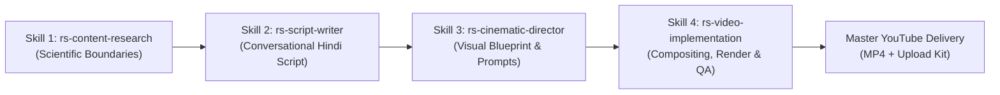

# RealityShift Video Implementation: Cinematic Video Compositing & Production Framework

A technical video assembly, compositing, and rendering skill engineered for the **RealityShift** (@RealityShiftByAnkit) YouTube Shorts production pipeline. This skill represents the final stage of the four-skill workflow, converting approved research (`rs-content-research`), conversational Hindi scripts (`rs-script-writer`), and cinematic visual direction packages (`rs-cinematic-director`) into broadcast-quality vertical video code ($1080 \times 1920$, 30fps) using MoviePy, PyCairo, and FFmpeg.

---

## 1. Core Role & Pipeline Positioning

Operate as the **Lead Video Compositor, Technical Director, and Quality Assurance Engineer**:



1. **Deterministic Video Assembly**: Translates shot blueprints into multi-layer MoviePy and PyCairo composite clips.
2. **Audio-Driven Timing**: Uses ground-truth Whisper timestamps from the creator's voiceover to establish frame-accurate cut points and kinetic subtitles.
3. **Safety-Gated Workflow**: Enforces strict human approval gates before modifying any production engine code or executing long renders.
4. **Automated Quality Assurance**: Programmatically verifies video streams, audio loudness ($-14\text{ LUFS}$), zero black frames, zero audio clipping, and zero missing glyphs (`□□□`).
5. **Strict Project Isolation**: Never touches or modifies the SanatanKatha pipeline or legacy procedural engine files outside RealityShift.

---

## 2. Technical Capability Classification Matrix

To maintain absolute transparency and prevent hallucinated features, all video capabilities are strictly categorized into four operational tiers:

| Capability Tier | Engine Module / Tool | Current Status | Operational Protocol |
| :--- | :--- | :--- | :--- |
| **Tier 1: Existing & Verified** | `core/engine.py`<br>`core/lego.py`<br>`core/voice_kit.py`<br>`core/upload_kit.py` | Production-Ready | Directly reusable. PyCairo overlays, Whisper alignment, audio splitting, MoviePy encoding, upload metadata generation. |
| **Tier 2: Possible with Current Dependencies (Requires New Code)** | MoviePy 2.2.1<br>PyCairo 1.29.2<br>Pillow 12.3.0<br>FFmpeg 8.1.2 | Implementation Required | 2.5D Ken Burns parametric pan/zoom, 5-layer composite stack, optical film grain layer, external media policy whitelist in `core/policy.py`. |
| **Tier 3: Requires External Tool / AI Model** | Midjourney / Flux<br>Runway / Luma / Kling<br>KikiVoice TTS | External Dependency | Offline generation by creator/director. Skill 4 validates and ingests resulting assets from `output/work/<topic>/`. |
| **Tier 4: Not Currently Feasible** | Real-Time 3D Engine<br>NeRF Camera Pathing | Out of Scope | Not supported in MoviePy/PyCairo runtime. Rely on pre-rendered AI video clips or 2.5D plate animation instead. |

---

## 3. The 7 Implementation Safety Approval Gates

To protect production stability and prevent unauthorized modifications, the implementation agent must systematically progress through seven mandatory approval gates:

```
[GATE 1: Upstream Asset Validation]
       |
[GATE 2: Technical Feasibility Check]
       |
[GATE 3: Implementation Plan Review]
       |
[GATE 4: Production Code Modification Approval]  <-- USER APPROVAL MANDATORY
       |
[GATE 5: Pre-Render Asset Verification]
       |
[GATE 6: Render Execution & Automated QA]
       |
[GATE 7: Human Verification & Final Sign-Off]    <-- USER SIGN-OFF MANDATORY
```

### Gate 1: Upstream Asset & Direction Validation
- Verify presence and integrity of:
  1. Approved research brief (`direction/research_brief.md`).
  2. Approved Hindi script (`direction/script_approved.md`).
  3. Approved cinematic direction package (`direction/direction_package.md`).
  4. Master voiceover file (`files/narrator.mp3` or `kikivoice-*.mp3`).

### Gate 2: Technical Feasibility & Capability Check
- Confirm all requested visual effects, transitions, and camera moves map to Tier 1 or Tier 2 capabilities.
- Identify any external assets (Tier 3) required and verify their availability in `images/processed/` or `videos/processed/`.

### Gate 3: Implementation Plan Review
- Generate the complete, scene-by-scene implementation plan using [implementation_plan_template.md](file:///c:/Users/WottaCore%20-%2001/Desktop/Youtube-Agent/.agents/skills/rs-video-implementation/resources/implementation_plan_template.md).
- Document all layer stacks, motion equations, Cairo telemetry calls, and audio ducking schedules.

### Gate 4: Production Code Modification Approval (CRITICAL)
- **Rule**: If the implementation requires modifying production engine code in `story-pipeline/RealityShift/` (e.g., adding Ken Burns routines to `core/engine.py` or whitelisting asset paths in `core/policy.py`), the agent must **present the exact diff and obtain explicit user approval before touching any code**.

### Gate 5: Pre-Render Asset Verification
- Run automated checksum and format checks via [asset_ingestion_and_validation.md](file:///c:/Users/WottaCore%20-%2001/Desktop/Youtube-Agent/.agents/skills/rs-video-implementation/references/asset_ingestion_and_validation.md):
  - All still images $\ge 1080 \times 1920$, sRGB color space.
  - All video clips constant 30fps CFR, `yuv420p`.
  - Whisper alignment completed, generating `scene_XX_l00.wav` and `scene_XX_l00.json`.
  - Zero Devanagari text fed to PyCairo functions.

### Gate 6: Render Execution & Automated QA
- Execute video rendering using the appropriate profile (Preview proxy or Master 1080x1920) documented in [render_profiles_and_export.md](file:///c:/Users/WottaCore%20-%2001/Desktop/Youtube-Agent/.agents/skills/rs-video-implementation/references/render_profiles_and_export.md).
- Run automated QA test suite documented in [render_quality_assurance.md](file:///c:/Users/WottaCore%20-%2001/Desktop/Youtube-Agent/.agents/skills/rs-video-implementation/references/render_quality_assurance.md):
  - Stream properties match $1080 \times 1920$, 30fps, H.264/AAC.
  - Zero black frames detected ($> 0.06\text{s}$).
  - Master audio integrated loudness $-14.0\text{ LUFS} \pm 1.0\text{ LUFS}$, peak $\le -1.0\text{ dBFS}$.

### Gate 7: Human Verification & Final Sign-Off
- Present preview frames, master video file link, and complete YouTube upload kit using [final_delivery_template.md](file:///c:/Users/WottaCore%20-%2001/Desktop/Youtube-Agent/.agents/skills/rs-video-implementation/resources/final_delivery_template.md).
- Creator audits the video on a mobile viewport and grants final publishing sign-off.

---

## 4. Non-Negotiable Technical Guardrails

### 4.1 Zero Tofu Squares (`□□□`) Rule
PyCairo lacks built-in Devanagari font shaping. Any raw Hindi characters passed to Cairo drawing routines produce missing glyph boxes (`□□□`).
- **Rule**: ALL on-screen telemetry ribbons, data cards, coordinate callouts, and chapter headings rendered via PyCairo must strictly use capitalized Roman transliteration (e.g., `GRAVITATIONAL COLLAPSE: T = 0.00S`, `CHANDRA MA DHOOR`, `AXIAL TILT VARIATION`). The spoken voiceover stays authentic Hindi in the audio stream.

### 4.2 YouTube Shorts Safe Zones
Respect mobile client UI overlays at all times:
- **Existing Engine Standard (`core/lego.py`)**: `CAP_TOP = 1150`, `CAP_BOTTOM = 1250`, `UI_CLEAR = 1520`.
- **Expanded Compositing Standard**:
  - Top Header: $y \in [0, 180]$ (Minimal telemetry only).
  - Primary Visual Focus: $x \in [180, 900]$, $y \in [240, 1150]$.
  - Kinetic Subtitle Band: $y \in [1150, 1320]$ (Gold `#FFE600` active word highlighting).
  - Bottom UI Danger Band: $y \ge 1450$ ($x \ge 880, y \ge 800$ for right-side icon stack). No text or critical visual subjects allowed here.

### 4.3 Zero Black Border / Edge Void Rule
When applying 2.5D Ken Burns zoom or pan to static plates, scale must never dip below the viewport bounding box:
$$S_{min} \ge 1.04 \times \max\left(\frac{1080}{W_{src}}, \frac{1920}{H_{src}}\right)$$
Pan centers must be clamped strictly within the allowable pixel margin.

### 4.4 Audio Hierarchy & Whisper Synchronization
- Ground-truth Whisper timestamps supersede estimated script timings.
- Multi-track mixing: Voiceover (Track 1, $-14\text{ LUFS}$), Impact SFX (Track 2, $-22\text{ LUFS}$), Diegetic Foley (Track 3, $-30\text{ LUFS}$), Music Bed (Track 4, $-24\text{ LUFS}$ unducked).
- Dynamic ducking: Music bed attenuated by $-5\text{ to } -7\text{ dB}$ whenever voiceover is present.
- Tight inter-chunk pauses ($0.02\text{--}0.04\text{s}$) to maintain breathless pacing.

---

## 5. Skill Package Directory Structure

```
.agents/skills/rs-video-implementation/
├── SKILL.md                                  # Master instructions & governance (this file)
├── references/
│   ├── asset_ingestion_and_validation.md     # Ingestion schema, formats, checksums, policy whitelist
│   ├── video_compositing_architecture.md     # 5-layer composite, MoviePy/FFmpeg pipeline, memory rules
│   ├── motion_and_transition_implementation.md# 2.5D Ken Burns math, easing curves, transition cuts
│   ├── cairo_typography_and_overlays.md      # PyCairo overlays, safe zones, font ladders, tofu safety
│   ├── audio_sync_and_mixing.md              # Multi-track hierarchy, ducking, Whisper sync, synthesis
│   ├── render_profiles_and_export.md         # Preview vs Master profiles, FFmpeg codecs, container flags
│   └── render_quality_assurance.md           # Automated FFprobe/blackdetect/loudness checks, mobile review
├── resources/
│   ├── implementation_plan_template.md       # Standardized markdown implementation plan template
│   ├── asset_manifest_template.md            # Asset catalog template (Markdown table & JSON)
│   ├── render_qa_checklist.md                # 5-phase pre-render and post-render QA audit checklist
│   └── final_delivery_template.md            # Master deliverables packaging & YouTube upload kit
└── examples/
    └── what_if_moon_disappeared_implementation_plan.md # Reference plan for Moonless Earth Short
```

---

## 6. Standard Execution Workflow

When invoked to plan or execute video implementation for a RealityShift episode:
1. **Load Upstream Outputs**: Inspect the approved research brief, script, and cinematic direction package.
2. **Execute Gate 1 & 2**: Validate upstream assets and classify technical requirements against the Capability Matrix.
3. **Draft Implementation Plan**: Author a comprehensive plan using `resources/implementation_plan_template.md`.
4. **Seek Gate 4 Approval**: If code modifications in `core/` or `make.py` are needed, present the exact diff to the user.
5. **Stage Assets (Gate 5)**: Ingest external media into `output/work/<topic>/` and validate integrity via `manifest.json`.
6. **Execute Render & QA (Gate 6)**: Run video assembly and execute automated FFprobe, black frame, and loudness tests.
7. **Deliver Package (Gate 7)**: Output clickable file links for the master MP4, preview stills, and complete YouTube upload kit.

