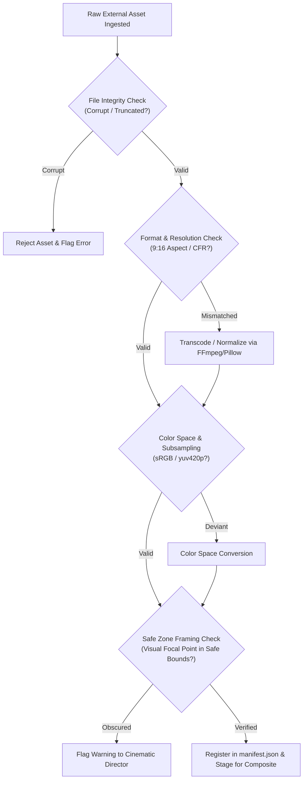

# RealityShift Asset Ingestion and Validation Reference

This reference establishes the technical requirements, directory structure, ingestion workflow, and validation protocols for external visual and audio assets in the RealityShift (@RealityShiftByAnkit) production pipeline.

---

## 1. Directory Structure Standards

All production assets for a specific episode must be organized strictly within the topic-specific workspace directory inside `story-pipeline/RealityShift/output/work/<topic>/`.

```
story-pipeline/RealityShift/output/work/<topic>/
├── direction/
│   ├── direction_package.md            # Approved output from rs-cinematic-director
│   ├── script_approved.md              # Approved output from rs-script-writer
│   └── research_brief.md               # Approved output from rs-content-research
├── files/
│   ├── kiki_narrator.txt               # Exported script with pause tags for KikiVoice
│   ├── narrator.mp3                    # Full master voiceover recording from creator
│   ├── scene_01_l00.wav                # Whisper-split scene audio clips
│   ├── scene_01_l00.json               # Word-level timestamp metadata
│   └── ...                             # Subsequent scene audio files
├── images/
│   ├── raw/                            # Original uncropped AI generation outputs
│   │   ├── SH01_A_raw.png
│   │   └── ...
│   ├── processed/                      # 9:16 aspect ratio, verified resolution assets
│   │   ├── SH01_A_img.png              # Standard still: 1080x1920 or 2160x3840
│   │   ├── SH02_A_img.png
│   │   └── ...
│   └── manifest.json                   # Asset registry with checksums and metadata
├── videos/
│   ├── raw/                            # Raw AI video generations (Runway, Luma, Kling)
│   ├── processed/                      # Standardized 30fps 1080x1920 MP4 clips
│   │   ├── SH01_A_vid.mp4
│   │   └── ...
│   └── video_manifest.json             # Video asset registry
├── sfx/                                # Custom external sound effects (if any)
│   ├── custom_whoosh.wav
│   └── sfx_manifest.json
└── build/                              # Intermediate and final render outputs
    ├── preview_frames/                 # Still frame renders for QA inspection
    ├── intermediate_composite.mp4      # Video track without audio
    ├── final_output.mp4                # Master delivery video
    └── render.log                      # Automated execution log
```

---

## 2. Technical Asset Specifications

### 2.1 Static Image Assets (AI Generated)
- **Primary Formats**: PNG (lossless, 8-bit or 16-bit RGB/RGBA) or high-quality JPEG (quality $\ge 95$).
- **Color Space**: sRGB IEC61966-2.1 (strictly non-CMYK; P3/AdobeRGB must be converted to sRGB to prevent washed-out browser playback).
- **Target Resolution**:
  - Minimum: $1080 \times 1920$ px (native 9:16 vertical).
  - Recommended for Ken Burns Motion: $1440 \times 2560$ px or $2160 \times 3840$ px ($4\text{K}$ vertical) to allow pan/zoom without down-sampling pixelation or sub-pixel blurring.
- **Compositional Framing**:
  - Visual focal points must fall within $x \in [180, 900]$ and $y \in [450, 1400]$ to remain fully visible beneath YouTube Shorts HUD overlays.

### 2.2 Dynamic Video Clips (AI Video Generated)
- **Primary Format**: MP4 container with H.264 (AVC) or H.265 (HEVC) video stream.
- **Frame Rate**: Exactly $30.0$ fps (or $29.97$ fps converted to constant $30.0$ fps). Variable frame rate (VFR) footage must be transcoded to Constant Frame Rate (CFR) before ingestion.
- **Pixel Aspect Ratio**: 1:1 (Square pixels).
- **Pixel Format**: `yuv420p` (strictly 8-bit 4:2:0 chroma subsampling for universal MoviePy/FFmpeg compatibility).
- **Motion Artifacts**: AI video generations must be inspected for frame warping, limb hallucinations, melting textures, and temporal flickering.

### 2.3 Audio Voiceover & Effects
- **Master Voiceover**:
  - Sample Rate: $44.1\text{ kHz}$ or $48.0\text{ kHz}$.
  - Bit Depth: 16-bit or 24-bit PCM WAV, or high-bitrate MP3 ($\ge 256\text{ kbps}$, CBR).
  - Channels: Mono (recommended for centered narration) or Stereo.
- **Split Scene Clips**:
  - Generated via `core/voice_kit.py` KikiVoice/Whisper splitting.
  - Format: $44.1\text{ kHz}$, 16-bit PCM WAV (`scene_XX_l00.wav`) with accompanied word alignment `.json`.

---

## 3. Policy Whitelisting & Safety Gate (Crucial Architecture Finding)

### 3.1 The YPP Anti-Repetition Policy Gate
In the existing RealityShift engine, `story-pipeline/RealityShift/core/policy.py` contains an automated anti-repetition check designed to prevent reused stock assets and maintain YouTube Partner Program (YPP) originality compliance.

Line 52 of `core/policy.py` defines `MEDIA_PATTERNS`, which flags or restricts external binary media files (`.png`, `.jpg`, `.mp4`, `.mp3`) unless explicitly managed.

```python
# From core/policy.py
MEDIA_PATTERNS = [
    # Patterns matching unauthorized external media
]
```

### 3.2 Whitelisting Protocol for Topic-Specific AI Assets
To introduce AI-generated images or external clips into a RealityShift build without violating policy checks:
1. **Explicit Topic Isolation**: Assets must reside *strictly* inside `output/work/<topic>/images/processed/` or `output/work/<topic>/videos/processed/`.
2. **Manifest Registration**: Every ingested asset must be cataloged in `manifest.json` with its cryptographic SHA-256 hash, creation timestamp, and corresponding Scene ID from the approved direction package.
3. **Engine Whitelist Update (Gate 4 Approval Required)**: If `policy.py` blocks external imports, a formal policy modification proposal must be submitted and approved by the user before editing `core/policy.py`. Never bypass policy checks silently.

---

## 4. Ingestion Validation Workflow

Before any asset is added to the implementation timeline, execute an automated verification pass:



### 4.1 Automated Validation Commands (Python / FFprobe)

To verify video clip integrity and properties using FFprobe:
```bash
ffprobe -v error -select_streams v:0 -show_entries stream=width,height,r_frame_rate,pix_fmt,codec_name,duration -of json input_clip.mp4
```

To verify image properties and color space using Pillow:
```python
from PIL import Image

def validate_image_asset(path: str):
    with Image.open(path) as img:
        img.verify() # Checks corruption
    with Image.open(path) as img:
        w, h = img.size
        mode = img.mode
        aspect = w / h
        expected_aspect = 9 / 16
        is_aspect_valid = abs(aspect - expected_aspect) < 0.02
        return {
            "path": path,
            "width": w,
            "height": h,
            "mode": mode,
            "aspect_ratio": f"{w}:{h}",
            "aspect_valid": is_aspect_valid,
            "ken_burns_ready": (w >= 1440 and h >= 2560)
        }
```

---

## 5. Asset Fallback Protocols

If an AI-generated visual asset fails validation, is unavailable, or exhibits visual distortion:
1. **Procedural Cairo Fallback**: Switch the scene to an existing vector procedural visual (starfield, cosmic grid, or particle field via `core/lego.py` and `core/engine.py`).
2. **Static Plate Pan Fallback**: If an AI video clip has severe temporal flickering, extract its best still frame, upscale it, and apply a 2.5D Ken Burns zoom instead.
3. **Clear Logging**: Every fallback must be logged in `build/render.log` with the exact reason for the asset substitution.

