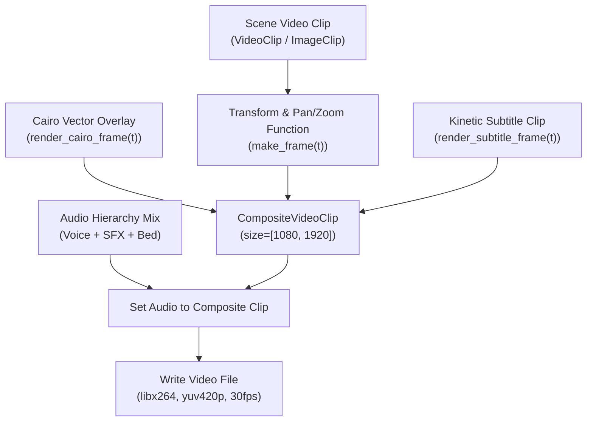

# RealityShift Video Compositing Architecture Reference

This reference details the visual compositing engine, layer hierarchy, rendering pipeline, memory management, and technical architecture for producing high-fidelity vertical YouTube Shorts in the RealityShift pipeline.

---

## 1. Multi-Layer Visual Compositing Stack

RealityShift videos are assembled as a deterministic 5-layer composite rendered at $1080 \times 1920$ resolution at $30.0$ frames per second:

```
+-------------------------------------------------------------+
| LAYER 5: Optical Grain & Master Vignette (Overlay/Blend)    |  <-- YPP Unifier & Texture
+-------------------------------------------------------------+
| LAYER 4: Kinetic Captions & Transliterated Subtitle Ribbons |  <-- Word-Level Highlight
+-------------------------------------------------------------+
| LAYER 3: PyCairo Vector Graphics, HUD Telemetry & Gridlines |  <-- 32-bit RGBA Overlay
+-------------------------------------------------------------+
| LAYER 2: Color Grade, Atmospheric Tint & Luminescence Bed   |  <-- Mood & Depth Adjust
+-------------------------------------------------------------+
| LAYER 1: Base Visual (AI Video Clip or Ken Burns Still)     |  <-- Primary Visual Canvas
+-------------------------------------------------------------+
```

### Layer 1: Base Visual Canvas
- **Source**: EITHER an ingested 9:16 AI video clip (Runway Gen-3, Luma, Kling) OR a high-resolution static plate ($1440 \times 2560$ to $2160 \times 3840$) animated with programmatic 2.5D Ken Burns motion.
- **Handling**: Scaled, centered, and cropped to exactly $1080 \times 1920$ without non-uniform stretching or aspect distortion.

### Layer 2: Atmospheric & Color Grade Bed
- **Function**: Harmonizes disparate visual styles, softens harsh AI generation artifacts, and establishes the episode's color script (Cosmic Cyan, Singularity Violet, Deep Magma, Deep Space Void).
- **Techniques**: Subtle radial vignette (darkening borders by $12\text{--}25\%$), non-destructive gamma adjustments, and atmospheric gradient washes that blend the base visual into the vector elements.

### Layer 3: PyCairo Vector Graphics & HUD Telemetry
- **Function**: Sci-fi scientific UI telemetry, coordinate axes, tracking brackets, vector diagrams, and orbital arcs.
- **Architecture**: Rendered via PyCairo directly into 32-bit RGBA NumPy image buffers (`cairo.ImageSurface.create_for_data`).
- **Isolation Rule**: All Cairo coordinate transforms must be wrapped strictly in `ctx.save()` and `ctx.restore()` to prevent coordinate matrix leaks across frames and scenes.

### Layer 4: Kinetic Subtitles & Typography
- **Function**: High-retention word-by-word or phrase-by-phrase kinetic captions synchronized to Whisper timestamps.
- **Placement**: Constrained strictly within safe zone bounds ($y \in [1150, 1320]$) with active word color highlighting (`#FFE600` Gold or `#00FFFF` Cyan) against a sleek semi-transparent backing plate (`rgba(0, 0, 0, 0.65)`).

### Layer 5: Film Grain & Master Unification
- **Function**: Procedural 35mm film grain or subtle digital noise applied at $2\text{--}4\%$ opacity.
- **Benefits**:
  1. Prevents 8-bit color banding in deep space gradients.
  2. Synthesizes a cohesive cinematic texture across mixed AI and vector elements.
  3. Provides micro-temporal variance that strengthens YouTube Partner Program originality metrics.

---

## 2. Rendering Engine Integration: MoviePy & FFmpeg

### 2.1 MoviePy Pipeline Architecture
The existing RealityShift pipeline (`story-pipeline/RealityShift/core/engine.py`) uses MoviePy (`VideoClip`, `AudioFileClip`, `CompositeVideoClip`).



### 2.2 Compositing Strategy Comparison

| Compositing Approach | Pros | Cons | Recommendation |
| :--- | :--- | :--- | :--- |
| **Pure MoviePy Generator** (`CompositeVideoClip`) | Fully integrated in Python, flexible procedural hooks, native Cairo interoperability. | Slower render times on long sequences, higher memory usage if clips accumulate. | **Recommended for Episode Assembly** with scene-by-scene memory cleanup. |
| **FFmpeg Filter Complex** (`filter_complex`) | Extremely fast, hardware-accelerated (CUDA/NVENC), low memory footprint. | Complex syntax for dynamic subtitle timing, rigid programmatic branching. | **Recommended for Final Export / Pass-Through** (grain overlay, audio mastering, final container remux). |
| **Hybrid Pipeline** (MoviePy Scenes $\to$ FFmpeg Concatenation) | Modular scene generation, bounded memory per scene, robust error isolation. | Requires intermediate file management on disk. | **Best Production Architecture** for long or complex Shorts. |

---

## 3. Memory Management & Performance Optimization

Rendering 60 seconds of 32-bit $1080 \times 1920$ frames at $30\text{ fps}$ requires computing 1,800 frames. Uncompressed, each raw frame occupies $\approx 8.3\text{ MB}$, totaling over $14.9\text{ GB}$ of uncompressed pixel data if held in memory.

### 3.1 Strict Memory Guardrails
1. **Scene-by-Scene Generation**: Render individual scenes as discrete clips or generators. Never instantiate all 1,800 frames simultaneously in memory.
2. **Explicit Garbage Collection**: In Python/MoviePy loops, call `clip.close()`, clear surface buffers, and invoke `gc.collect()` at the boundary of each scene.
3. **Chunked Audio Processing**: Audio clips must be streamed from disk via `AudioFileClip` rather than preloaded as entire uncompressed floating-point arrays.
4. **Pillow & Cairo Surface Cleanup**: Ensure Cairo surfaces are closed or overwritten in-place rather than allocating new memory on every frame iteration.

### 3.2 Threading & Core Allocation
- On Windows systems with modern multi-core processors, configure MoviePy's `write_videofile` with:
  ```python
  threads = 4  # Avoid thread exhaustion; 4-8 threads is optimal for x264 on desktop systems
  fps = 30
  preset = "medium"  # Balance between compression ratio and encoding speed
  ```

---

## 4. Temporary Cache Architecture & Cleanup

Intermediate render artifacts must be contained in a dedicated, disposable cache directory:
`story-pipeline/RealityShift/output/work/<topic>/build/temp/`

### 4.1 Lifecycle Rules
- **Creation**: The implementation runner initializes `build/temp/` at the start of a render run.
- **Intermediate Files**: Normalized audio WAVs, rendered scene previews, and intermediate MP4 segments are written here.
- **Automatic Post-Render Cleanup**: Upon successful creation of `final_output.mp4` and passage of automated QA, all intermediate `.tmp` files must be purged, retaining only:
  - `build/final_output.mp4`
  - `build/render.log`
  - `build/preview_frames/` (1 still frame per scene for visual auditing).

