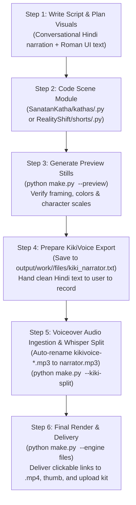

# YouTube Generator — Agent & Production Master Guide

> **MANDATORY FOR ALL AI AGENTS & COLLABORATORS**: Read this document in full before generating, editing, or rendering any YouTube Short in this repository. Follow every rule strictly to guarantee zero production bugs, perfect visual framing, and full compliance with YouTube Partner Program (YPP) policies.

---

## 1. Project Overview & Channels

This repository is an autonomous procedural 2D animation and rendering pipeline for YouTube Shorts (1080x1920, 9:16 vertical).
Every visual frame is dynamically drawn via code using **PyCairo**, and audio is composed via **NumPy synthesis**, **user-provided KikiVoice voiceover**, and **MoviePy/FFmpeg encoding**.

There are two completely independent channels:

| Channel Folder | YouTube Channel | Topic & Content Style | Entry Point |
|---|---|---|---|
| **[`SanatanKatha/`](SanatanKatha/)** | **Divya Rahasya** | Hindu mythology, sacred temple lore, Devta character rigs, Kathavachak storytelling, spiritual bells & flute music | `cd SanatanKatha && python make.py <katha>` |
| **[`RealityShift/`](RealityShift/)** | **Reality Shift** | Geopolitics, defence technology, strategic corridors, tactical maps, military blueprints, driving pulse & tension music | `cd RealityShift && python make.py <short>` |

Both channels have isolated engines and output folders so modifying one pipeline will **never** break the other.

---

## 2. Directory Architecture & Storage Standards

```
Youtube-Generator/
├── README.md                      # This master guide
├── AGENTS.md                      # Agent rules & constraints
├── requirements.txt               # Shared Python packages (pycairo, moviepy, numpy, openai-whisper)
├── .editorconfig  .gitignore       # Git rules (ignores output/, .cache/, *.log, __pycache__)
├── .cache/
│   └── whisper/                   # SHARED WHISPER CACHE (holds small.pt; DO NOT DUPLICATE)
│
├── RealityShift/                  # Channel 1: Defence & Geopolitics
│   ├── make.py                    # Entry point runner
│   ├── README.md                  # Channel specific notes
│   ├── core/                      # engine.py, lego.py, delivery.py, policy.py, upload_kit.py, voice_kit.py
│   ├── data/                      # policy_history.json (tracks shipped styles & YPP history)
│   ├── shorts/                    # Python script per Short (e.g. arihant.py, imec.py, pinaka.py)
│   └── output/
│       ├── preview/               # Visual contact sheets and preview stills
│       ├── shorts/                # Final deliverables: .mp4, _thumb.png, _upload.md, .json
│       └── work/<topic>/files/    # Active voiceover audio (narrator.mp3), split clips, texts
│
└── SanatanKatha/                  # Channel 2: Divya Rahasya (Mythology)
    ├── make.py                    # Entry point runner
    ├── README.md                  # Channel specific notes
    ├── core/                      # engine.py, devta.py, katha.py, policy.py, upload_kit.py, voice_kit.py
    ├── data/                      # policy_history.json (tracks shipped styles & YPP history)
    ├── kathas/                    # Python script per katha (e.g. lepakshi.py, barbarik.py, _template.py)
    └── output/
        ├── preview/               # Visual contact sheets and preview stills
        ├── shorts/                # Final deliverables: .mp4, _thumb.png, _upload.md, .json
        └── work/<topic>/files/    # Active voiceover audio (narrator.mp3), split clips, texts
```

### Critical Storage Rules (Never Violate)
1. **Shared Whisper Cache**: Both channels share `.cache/whisper/small.pt` located at the root of `Youtube-Generator/`. **NEVER** download or place another `small.pt` inside `SanatanKatha/.cache` or `RealityShift/.cache`.
2. **No Accidental Subdirectories**: Never run commands that create nested channel folders (e.g. `RealityShift/RealityShift`). Always `cd` into the channel folder or run relative commands cleanly.
3. **No Redundant `.venv` in Subfolders**: The machine uses Python 3.12 globally. Do not create virtualenvs in subdirectories.

---

## 3. End-to-End Production Protocol (Step-by-Step)

When the user asks you to create a new Short (e.g., *"Make a short on Topic X"*), follow these 6 steps in exact sequence:



---

### Step 1: Script & Voiceover Writing Rules

1. **Conversational Hindi (Zero Pure-Sanskrit Jargon)**:
   - Do **NOT** use archaic, textbook Sanskritized Hindi that sounds like a dry 1980s Doordarshan documentary.
   - *Bad*: `अथाह गहराइयों में तैरता महाविनाशक अस्त्र`, `खोजी तरंगें`, `परमाणु भट्टी`
   - *Good*: `समंदर के गहरे पानी में चुपचाप तैर रहा है`, `दुश्मन की पकड़ में नहीं आने देता`, `परमाणु ताकत`
2. **Strict Zero English Words in Spoken Voiceover (TTS Accent Protection)**:
   - KikiVoice and Indic TTS engines abruptly switch accents to an awkward robotic American tone when encountering English words, units, or transliterations.
   - **Never** include English words in spoken narration:
     - ❌ Avoid: `meter`, `satellite`, `radar`, `nuclear reactor`, `gas pressure`, `diesel submarine`, `base`, `comment`, `subscribe`.
     -  Use: `मीटर` -> `सैकड़ों फुट नीचे`, `सैटेलाइट/रडार` -> `दुश्मन की नजरें / खोजी आंखें`, `कमेंट/सब्सक्राइब` -> `अपनी राय जरूर बताएं`.
3. **On-Screen Graphics MUST Be Capitalized Roman Transliteration**:
   - The PyCairo engine renders on-screen UI with the `Impact` font (`CAPTION_FONT`), which lacks Devanagari glyphs. Any raw Hindi in UI elements produces ugly empty boxes / tofu squares (`□□□`).
   - **Rule**: All titles, ribbons, cue cards, and prompt text **must** be written in capitalized Roman script (e.g. `HAWA MEIN JHULTA KHAMBHA`, `KARM CHAKRA`, `OPERATION MEGHDOOT`, `APNI RAI ZARUR DEIN`). The spoken narration remains pure Hindi.

---

### Step 2: Coding the Scene Module

1. **File Placement**:
   - For Divya Rahasya: `SanatanKatha/kathas/<topic>.py` (based on `kathas/_template.py` or existing stories like `lepakshi.py`, `kailash.py`).
   - For RealityShift: `RealityShift/shorts/<topic>.py` (based on `shorts/arihant.py`, `imec.py`, or `pinaka.py`).
2. **Required Scene Structure**:
   - Every module must define:
     - `SPEC`: Metadata (title, hook, music style, BPM, tempo, character voices).
     - `SCENE_CLASSES`: Dictionary mapping scene keys to their respective PyCairo scene classes.
     - `SCRIPT`: Scene chunks with voiceover lines and pause durations.
     - `thumbnail(ctx)`: High-CTR 1080x1920 thumbnail drawer function.
     - `UPLOAD`: Title options, description, SEO tags, pinned comment.
3. **YPP Anti-Repetition Rotation (Every 2 Shorts)**:
   - **Music Style**: Rotate across `divine`, `ambient`, `tension`, `pulse`, `march`. Never use the same style 3 times in a row.
   - **Music BPM**: Shift BPM by **6 to 14 BPM** compared to the previous Short in `data/policy_history.json`.
   - **Scene Count**: Alternate between 5 scenes (punchy), 6 scenes (balanced), 7 scenes (deep lore), and 8 scenes (epic journey).

---

### Step 3: Visual Composition & PyCairo Framing Rules

1. **Minimal Text, Maximum Visuals ("Text Kam, Visuals Jyada")**:
   - Never clutter the screen with heavy text boxes or multi-line dialogue boxes.
   - Use ultra-sleek, single-line ribbons placed at the top (`y = 280–380`).
2. **Character Scaling & No Clipping**:
   - Standard character scale must stay between **`0.68` and `0.80`** (NEVER `1.0+` or `1.3–1.5`).
   - Feet must always sit at `GROUND - 10` (`y ≈ 1170`).
   - At this scale, the top of the crown/head stays at `y ≈ 500–550`, leaving clean breathing room under the top header (`y = 78–146`) and avoiding collisions with bottom captions (`CAP_Y = 1290`).
   - In 2-character scenes, position characters at `x ≈ 230–250` and `x ≈ 750–850` (~500px apart) so neither clips against screen borders.
3. **Character Authenticity**:
   - **Shri Rama (Treta Yuga)**: Royal warrior mukut (NO peacock feather!), Raghuvanshi tilak, Kodanda bow on shoulder, deep saffron robes.
   - **Shri Krishna (Dwapara Yuga)**: Mor-pankh (peacock feather), flute or Abhaya blessing mudra, Pitambar yellow dhoti.
   - Commoners, rishis, soldiers, or engineers must **not** wear royal golden crowns (`mukut`). Use authentic context-driven attire.
4. **Previews First**:
   - Run `python make.py <topic> --preview` to render contact sheets in `output/preview/<topic>_sheet.png`. Show these to the user to inspect visuals before spending voiceover time.

---

### Step 4 & 5: Voiceover Export, Audio Ingestion & Whisper Splitting

1. **Export Voiceover Text**:
   - Save the narrator script to:
     - `SanatanKatha/output/work/<topic>/files/kiki_narrator.txt`
     - `RealityShift/output/work/<topic>/files/kiki_narrator.txt`
   - Provide the clean spoken Hindi text directly to the user so they can generate or record audio in KikiVoice.
2. **Handle Incoming Audio File**:
   - Check `output/work/<topic>/files/` for the user's audio file.
   - If it has a KikiVoice default name (e.g. `kikivoice-tts-file-*.mp3`), automatically copy/rename it to `narrator.mp3`.
3. **Run Whisper Alignment & Cutting**:
   ```bash
   python make.py <topic> --kiki-split
   ```
   - This automatically uses the shared `.cache/whisper/small.pt` model.
   - It aligns the audio to the script using Needleman-Wunsch dynamic programming and produces `scene_01_l00.wav`, `scene_02_l00.wav`, etc., and word-timing JSONs (`scene_01_l00.json`).

---

### Step 6: Full Render & Delivery

1. **Render the Video**:
   ```bash
   python make.py <topic> --engine files
   ```
   (If running from root: `cd <Channel> && python make.py <topic> --engine files`)
2. **Outputs Generated in `<Channel>/output/shorts/`**:
   - `<topic>_short.mp4`: Final vertical video with music, user's voiceover, animated characters, dynamic subtitles, and SFX.
   - `<topic>_short_thumb.png`: High-resolution YouTube thumbnail.
   - `<topic>_short_thumb_feed.png`: Shorts feed square preview.
   - `<topic>_short_upload.md`: Ready-to-copy title, description, tags, pinned comment, and quality scores.
   - `<topic>_short.json`: Detailed scene timing log.
3. **Agent Delivery Format**:
   - Always present clickable markdown links for all generated assets:
     - `[video.mp4](file:///c:/Users/.../<Channel>/output/shorts/<topic>_short.mp4)`
     - `[thumbnail.png](file:///c:/Users/.../<Channel>/output/shorts/<topic>_short_thumb.png)`
     - `[upload_kit.md](file:///c:/Users/.../<Channel>/output/shorts/<topic>_short_upload.md)`
   - Show the final title, description, and pinned comment in the response so the user can easily upload.

---

## 4. Command Cheat-Sheet

All commands must be executed from inside the respective channel directory (`cd SanatanKatha` or `cd RealityShift`).

| Action | SanatanKatha (Divya Rahasya) | RealityShift |
|---|---|---|
| **List all Shorts & render status** | `python make.py --list` | `python make.py --list` |
| **Check YPP Policy & Repetition Rules** | `python make.py <name> --check` | `python make.py <name> --check` |
| **Generate visual preview sheet (Fast)** | `python make.py <name> --preview` | `python make.py <name> --preview` |
| **Export KikiVoice text files** | `python make.py <name> --kiki-export` | `python make.py <name> --kiki-export` |
| **Split user audio via Whisper** | `python make.py <name> --kiki-split` | `python make.py <name> --kiki-split` |
| **Final Render with user's voiceover** | `python make.py <name> --engine files` | `python make.py <name> --engine files` |
| **Rebuild Upload Kit & Thumbnail only** | `python make.py <name> --kit` | `python make.py <name> --kit` |

---

## 5. Agent DOs and DONTs Checklist

| What to DO (Mandatory) | What NEVER to do (Strictly Forbidden) |
|---|---|
| **DO** check `.cache/whisper/small.pt` at root before touching Whisper. | **NEVER** re-download Whisper models into channel subfolders. |
| **DO** use conversational, thrilling, natural Hindi in voiceovers. | **NEVER** use textbook Sanskrit jargon or Doordarshan-style robotic Hindi. |
| **DO** replace English units & loanwords with Hindi in voiceover. | **NEVER** leave English words in Hindi voiceover (glitches TTS accent). |
| **DO** write all on-screen graphics in capitalized Roman letters. | **NEVER** put Hindi Unicode in PyCairo text (produces `□□□` tofu squares). |
| **DO** scale characters between `0.68` and `0.80` with feet at `GROUND - 10`. | **NEVER** scale characters at `1.0+` or `1.5` (clips crowns and captions). |
| **DO** rotate music style and shift BPM by 6-14 BPM every 2 shorts. | **NEVER** use identical music beds or BPMs 3 shorts in a row. |
| **DO** present preview stills to the user before recording audio. | **NEVER** use AI edge-tts fallback for final video renders. |
| **DO** provide clickable `file:///` links for `.mp4`, thumb, and upload kit. | **NEVER** leave the user without ready-to-copy YouTube upload metadata. |
